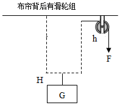

# Physics - 题目 187

**ID**: 0ecdf4e1d218492b818c841b5a83f108
**年级**: Grade 8
**难度**: Medium-Hard
**题型**: Experiment

## 题目
物理实验兴趣小组间开展竞赛活动，甲组出题乙组用实验的方法解答；甲组用布帘将一个滑轮组遮蔽（如图），乙组同学通过测量：滑轮组下方所挂重物重力为G，重物被匀速提升的高度为H，乙组同学施加在滑轮组绕绳的自由端的拉力为F，该自由端移动的距离为h；通过3组实验（数据见下表）乙组同学探究出“布帘背后的秘密”；实验次数123G/N5.08.011.0F/N2.03.04.1H/cm10.015.020.0h/cm30.145.160.2假设你是乙组成员请判断：【小题】（1）动滑轮实际被使用的个数是（选填“一个”或“两个”）；【小题】（2）请在图中画出布帘后的滑轮组及绕线的方法；【小题】（3）滑轮组中所有动滑轮（及动滑轮间的连接物）总重力约为（选填“1N”、“2N”或“3N”）；【小题】（4）当提升重物重力为G＝4.0N时，该滑轮组的机械效率最接近（选填“80%”、“33%”或“25%”）；从三次实验数据可以得出：使用同一滑轮组提升重物时，越大，滑轮组的机械效率越高；【小题】（5）乙组同学发现实验数据不像“理想模型”那样完美，请你提出一条产生误差的原因：。​​​​​​​‌

## 解答

1. （1）绳子的有效段数
2. $n=\frac {h}{H}=\frac {30.1cm}{10.0cm}\approx 3$
3. 故动滑轮实际被使用的个数是一个（若是两个，有效段数为4或5）
4. （2）有3段绳子拉着动滑轮，由图可知，从滑轮组出来的绳子的方向是水平方向，则还需要一个定滑轮；绳子先连接动滑轮上端的挂钩，然后绕过定滑轮、动滑轮、另一个定滑轮，如图所示：
5. 
6. （3）若不考虑摩擦，则由 $F{\rm{=}}\frac {G{\rm{+}}G{{}_{动}}}{3}$ 可知，滑轮组中所有动滑轮（及动滑轮间的连接物）总重力约为
7. $G{{}_{动}}＝3F﹣G＝2{\rm{.}}{\rm{0}}{\rm{N}}{\rm{×}}{\rm{3}}﹣{\rm{5}}{\rm{.}}{\rm{0}}{\rm{N}}＝{\rm{1}}{\rm{N}}$
8. （4）如不考虑摩擦，当提升重物重力为G＝4.0N时，根据
9. $η=\frac {W{{}_{有用}}}{W{{}_{总}}}\times 100\%{\rm{=}}\frac {W{{}_{有用}}}{W{{}_{总}}{\rm{+}}W{{}_{额}}}{\rm{=}}\frac {Gh}{Gh+G{{}_{动}}h}\times 100\%=\frac {G}{G+G{{}_{动}}}\times 100\%$
10. 可知，该滑轮组的机械效率为
11. $η\prime {\rm{=}}\frac {{\rm{4}}{\rm{.}}{\rm{0}}{\rm{N}}}{{\rm{4}}{\rm{.}}{\rm{0}}{\rm{N}}{\rm{+}}{\rm{1}}{\rm{N}}}=80\%$
12. 故该滑轮组的机械效率最接近80%。
13. 由表中数据知，第1次实验的机械效率为
14. $η=\frac {W{{}_{有用}}}{W{{}_{总}}}\times 100\%{\rm{=}}\frac {G^{′}h}{F^{′}s}\times 100\%=\frac {5.0{\rm{N}}\times 0.1{\rm{m}}}{2.0{\rm{N}}\times 0.301{\rm{m}}}\times 100\%\approx 83\%$
15. 同理可知，第2次、3次的机械效率分别为：88%、89%；由此可知，使用同一滑轮组提升重物时，物重越大，滑轮组的机械效率越高。
16. （5）乙组同学发现实验数据不像“理想模型”那样完美，产生误差的原因：绳与轮之间存在摩擦。

## 知识点

**中文**:
  - 滑轮（组）的机械效率的测量实验

**English**:
  - Experiment: Measuring Mechanical Efficiency of Pulleys

---
