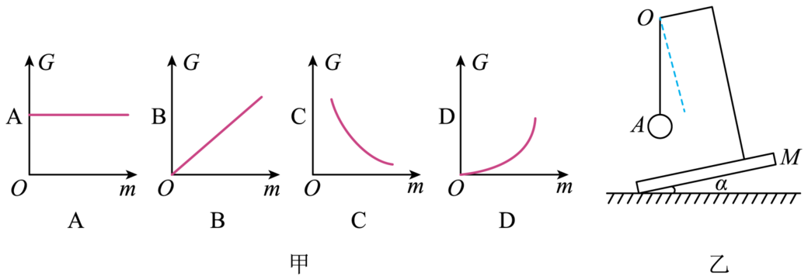

# Physics - 题目 2356

**ID**: 0fcdd81a4f824c03a50e5ed82b0d1eac
**年级**: Grade 8
**难度**: Medium-Hard
**题型**: Experiment

## 题目
某物理小组在探究“物体所受重力大小与物体质量关系”和“探究重力方向”实验中，进行了如下的实验测量和操作：（1）其中在探究“物体所受重力大小与物体的质量关系”时，记录的实验数据如下表所示：实验次序012345被测物体无物体1物体2物体3物体4物体5物体质量 $m\left ({{\rm{k}}{\rm{g}}}\right )$00.10.20.30.40.5所受重力 $G\left ({{\rm{N}}}\right )$00.981.962.943.924.90①在该实验探究过程中，需要的测量工具有弹簧测力计和；②分析上表中的实验数据可初步得出的实验结论是；③根据上表中测量的实验数据分析图甲，其中能正确描述物体所受的重力 $G$ 与质量 $m$ 关系的图像是（填字母）；（2）在探究重力方向时，采用的实验装置如图乙所示，将该装置放在水平桌面上后，缓慢改变木板M与桌面的夹角 $a$ ，会观察到悬线OA的方向（选填“变化”或“不变”）；如果剪断悬线 $OM$ ，则原来静止的小球将会（选填“竖直”或“垂直于木板M”）下落。​​​​​​​‌

## 解答

1. （1）①[1]实验中需要测量的物理量有质量与重力，所以测量工具为：弹簧测力计和天平。
2. ②[2]分析表中数据，物体所受的重力随质量的增加而增大，且重力与质量的比值是常数，说明：物体所受的重力跟它的质量成正比。
3. ③[3]因物体所受的重力跟它的质量成正比，故重力随质量的变化关系图像为过原点的直线，故选B。
4. （2）[4][5]缓慢改变木板M与桌面的夹角a，悬线OA由于受重力的作用始终处于竖直方向，它的方向不变。因为重力的方向总是竖直向下的，剪断悬线OA，则原来静止的小球将会竖直向下运动。

## 知识点

**中文**:
  - 探究物重与物体质量的关系实验
  - 重力的方向

**English**:
  - Experiment: Relationship between Weight and Mass
  - Direction of Gravity

---
