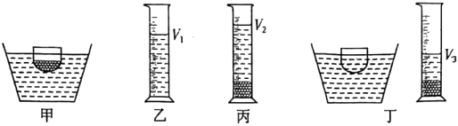

# Physics - 题目 1535

**ID**: 15a19f2979dd4790abe2a61d3c99c539
**年级**: Grade 8
**难度**: Medium-Hard
**题型**: Experiment

## 题目
受“曹冲称象”的启发，如图，小明在家利用量筒、碗、水盆和足量的水（密度为ρ_{水}）、油性笔等，测量鹅卵石的密度。​​​​​​​‌（1）小明同学设计的实验步骤如下，请将步骤④补充完整。①如图甲，将鹅卵石放入空碗中，再把碗放入盛有水的水盆中，用油性笔在碗外壁上标记水面的位置；②如图乙，往量筒内倒入适量的水，记下量筒中水的体积V_{1}；③如图丙，取出碗中的鹅卵石并放入量筒中，记下鹅卵石和水的总体积V_{2}；④如图丁，将量筒中的水慢慢倒入水盆中的空碗内，直到标记处与碗外水面，记下量筒中鹅卵石和剩余水的总体积V_{3}。（2）根据实验得出，鹅卵石密度的表达式为ρ＝。（均选用V_{1}、V_{2}、V_{3}和ρ_{水}表示）（3）若在步骤④将量筒中的水倒入水盆中的空碗内时，有部分水悬挂在量筒的内壁上，则所测得鹅卵石的质量，鹅卵石的密度。（均选填“偏大”或“偏小”）

## 解答

1. （1）图丁中将量筒中的水慢慢倒入水盆中的空碗内，直到标记处与碗外水面相平，记下量筒中鹅卵石和剩余水的总体积V_{3}，根据等效替代法可知，量筒中减小的水的质量即鹅卵石的质量。
2. （2）量筒中减小水的体积ΔV=V_{2}-V_{3}
3. 根据 $ρ=\frac {m}{V}$ 可得减小水的质量，即鹅卵石的质量m＝Δm_{水}＝ρ_{水}ΔV＝ρ_{水}（V_{2}-V_{3}）
4. 则鹅卵石密度的表达式为 $ρ=\frac {m}{V}=\frac {ρ{{}_{水}}\left ({V{{}_{2}}-V{{}_{3}}}\right )}{V{{}_{2}}-V{{}_{1}}}$
5. （3）若在步骤④将量筒中的水倒入水盆中的空碗内时，有部分水悬挂在量筒的内壁上，则量筒中鹅卵石和剩余水的总体积V_{3}读出的数据变小，量筒中减小水的体积偏大，根据m=ρ_{水}ΔV=ρ_{水}（V_{2}-V_{3}）
6. 得出，所测得鹅卵石的质量偏大，则根据 $ρ=\frac {m}{V}$ 可知，鹅卵石的密度偏大。

## 知识点

**中文**:
  - 固体密度的测量实验

**English**:
  - Experiment: Measuring Density of Solids

---
