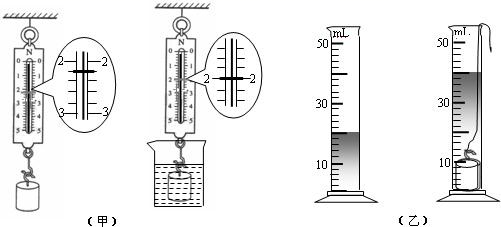

# Physics - 题目 898

**ID**: 16d14081c525487796992243bb498fac
**年级**: Grade 8
**难度**: Medium-Hard
**题型**: Experiment

## 题目
为了探究物体的浮沉条件,实验室提供了如下器材：弹簧测力计、量筒、烧杯、金属块、木块、细线、水及其他简单辅助器材。​​​​​​​‌第一小组：探究金属块的下沉条件。实验中,他们用两种方法测量了物体受到的浮力：（1）方法1：称重法。测量过程及示数如图(甲)所示,则空气中金属块的重力为N，金属块所受的浮力为N；（2）方法2：阿基米德原理法。测量过程与示数如图（乙）所示,读出排开水的体积为m^{3}，根据F_{浮}=G_{水}=ρ_{水}gV_{排}，可计算出浮力为N；第二小组：探究木块上浮的条件。（3）要测量木块浸没时的浮力,你准备选用上述两方法中的方法(“1”或“2”),并简要说明操作中还应采取的措施。

## 解答

1. （1）从图甲可以看到，测力计的量程是0.2N，指针指在刻度2往下第一个刻度，它的读数是2.2N，即空气中金属块的重力为2.2N。
2. 从甲中的右图可以看到，金属块完全浸没在液体中，测力计拉着它，对金属块受力分析，它受到重力、浮力、测力计的拉力作用，而处于平衡状态，这三力平衡，从测力计上可知拉力的大小是2N，由解析可知，金属块的重力为2.2N，设浮力大小是F_{浮}，由三力平衡可得到关系式
3. $G=F{{}_{浮}}+F{{}_{拉}}$
4. 代入数据可得
5. ${\rm{2}}{\rm{.}}{\rm{2}}{\rm{N}}=F{{}_{浮}}+{\rm{2}}{\rm{N}}$
6. 解得 $F{{}_{浮}}={\rm{0}}{\rm{.}}{\rm{2}}{\rm{N}}$ ，金属块所受的浮力为0.2N。
7. （2）从图乙可以看到，量筒的量程是0~50mL，分度值是2mL，没放入金属块时，液体的体积是20mL，放入金属块后，液面的指示位置是40mL，这是液体和金属块的总体积，那么金属块的体积是
8. $V={\rm{4}}{\rm{0}}{\rm{m}}{\rm{L}}-{\rm{2}}{\rm{0}}{\rm{m}}{\rm{L}}={\rm{2}}{\rm{0}}{\rm{m}}{\rm{L}}={\rm{2}}{\rm{0}}{\rm{c}}{\rm{m}}{^{{\rm{3}}}}=2\times 1{\rm{0}}{^{{\rm{-}}{\rm{5}}}}{\rm{m}}{^{{\rm{3}}}}$
9. 金属块的体积是2×10^{-5}m^{3}，这也是排开水的体积，排开水的体积是2×10^{-5}m^{3}。
10. 由解析可知，排开水的体积是2×10^{-5}m^{3}，根据F_{浮}=G_{水}=ρ_{水}gV_{排}，可计算出浮力是
11. $F{{}_{浮}}=ρ{{}_{水}}gV{{}_{排}}=1.0\times 1{\rm{0}}{^{{\rm{3}}}}{\rm{k}}{\rm{g}}{\rm{/}}{\rm{m}}{^{{\rm{3}}}}\times 1{\rm{0}}{\rm{N}}{\rm{/}}{\rm{k}}{\rm{g}}\times 2\times 1{\rm{0}}{^{{\rm{-}}{\rm{5}}}}{\rm{m}}{^{{\rm{3}}}}=0{\rm{.}}{\rm{2}}{\rm{N}}$
12. 可计算出浮力是0.2N。
13. （3） 由于木块密度小于水，在水中是漂浮，假设用方法1去做实验，木块是漂浮在水中的，即使用细针使木块完全浸没，对木块受力分析，它受到重力、浮力、针的压力、还可能有测力计的拉力，这几个力平衡，由于不知道针的压力，只知道重力和测力计的拉力大小，这是不能得知浮力的大小，所以方法1不可行；假设用方法2去做实验，用细针使木块完全浸没，是可得知木块排开水的体积，水的密度也知道，那么可根据阿基米德原理，知道木块浸没时的浮力，所以方法2可行；操作中应采取的特别措施是使用助沉法，用细针使木块完全浸没。

## 知识点

**中文**:
  - 实验探究物体的浮沉条件
  - 阿基米德原理的应用

**English**:
  - Experiment: Investigating Floating/Sinking Conditions
  - Applications of Archimedes' Principle

---
