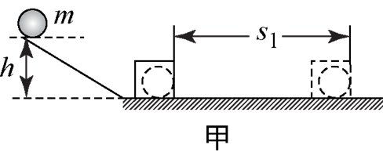
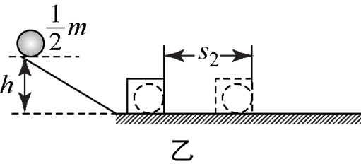
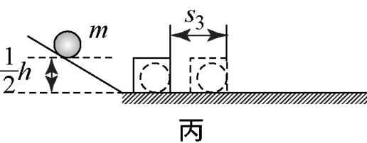

# Physics - 题目 433

**ID**: 1ca1e5b1250e4bbe9005f0209ece852f
**年级**: Grade 8
**难度**: Medium-Hard
**题型**: Experiment

## 题目
在探究“物体动能的大小与哪些因素有关”的实验中，小红同学设计了如图所示 甲、乙、丙三次实验。​​​​​​​‌让铁球从同一斜面上某处由静止开始向下运动，然后与放在水平面上的纸盒相碰，铁球与纸盒在水平面上共同移动一段距离后静止。（1）要探究动能大小与物体质量的关系应选用两图；实验中应保证铁球到达水 平面时的相同；（2）选用甲、丙两次实验可以得出的结论是；（3）该实验是通过观察来比较铁球动能的大小，从而得出结论的，这种研究方法的叫；（4）如本实验中水平面绝对光滑，本次实验将（选填“能”或“不能”）达到实验目的；（5）实验表明：质量相同物体，运动的速度越大，它的动能越；运动速度相同的物体，质量越大，它的动能也越。

## 解答

1. （1）要探究动能大小与物体质量的关系，应使小球到达水平面的速度相同，质量不同，所以应用质量不同的小球从同一高度处由静止滚下，所以应选用甲乙两图。
2. （2）甲、丙两次实验，小球的质量相同，滚下的高度不同，滚下的高度越大，达到水平面的速度越大，纸盒被推动得越远，说明小球的动能越大，可以得出的结论是在质量一定时，物体的速度越大，动能越大。
3. （3）该实验是通过铁球与纸盒共同移动的距离来表示小球具有的能量大小，用到了转换法。
4. （4）若水平面绝对光滑，由牛顿第一定律知道，钢球和木块将永远一直运动下去，没有运动距离的远近之分，就不能达到比较距离来比较动能的目的了。
5. （5）动能的决定因素有两个：质量和速度。让同一钢球从不同的高度滚下，是采用控制变量法，控制质量一定而速度不同，从斜面越高的位置滚下，钢球到达斜面底端的速度就越大。质量一定时，速度越大，动能就越大。钢球的质量越大，木块推得越远，说明在钢球速度相同的情况下，钢球的质量越大，动能就越大。

## 知识点

**中文**:
  - 探究影响物体动能大小因素的实验

**English**:
  - Experiment: Factors Affecting Kinetic Energy

---
