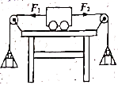
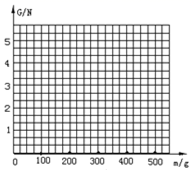

# Physics - 题目 414

**ID**: 1dd5fefedfdc4fdd930f31abde3af005
**年级**: Grade 8
**难度**: Medium-Hard
**题型**: Experiment

## 题目
探究二力平衡的条件过程步骤①如图，左右两盘放质量相等的砝码，小车保持静止，将两盘放在小车的同一侧，小车将运动，说明彼此平衡的两个力要；②将小车扭转一个角度，放手后小车将转动，说明彼此平衡的两个力要在。​​​​​​​‌③若将上述载置中的小车用轻质硬纸片替换，效果会更好，原因是减小了的影响。问题讨论④在探究“重力和质量关系的实验中，把钩码逐个挂在竖直的弹簧测力计下方，分别测出它们受到的重力，并记录在下面的表格中；质量 $m{\rm{/}}{\rm{g}}$100200400500重力 $G{\rm{/}}{\rm{N}}$123.85（1）根据表格数据作出 $G{\rm{-}}m$ 图像。（2）结论是物体所受的重力跟质量成（3）你认为用同样的器材，在太空站（选填“能”或“不能”）完成该探究。

## 解答

1. (1)[1]如图，左右两盘放质量相等的砝码，小车保持静止，将两盘放在小车的同一侧，小车将运动，说明彼此平衡的两个力要大小相等且方向相反。
2. [2]将小车扭转一个角度，放手后小车将转动，说明彼此平衡的两个力要在同一条直线上。
3. [3]若将上述载置中的小车用轻质硬纸片替换，效果会更好，原因是减小了摩擦力的影响，小车重力产生的压力产生摩擦力。
4. [4]根据表格数据，采用描点法作出 $G{\rm{-}}m$ 图像如图所示：
5. 。
6. (2)[5]由 $G{\rm{-}}m$ 图像可知，物体所受的重力跟质量的比值是一个定值，满足正比例函数关系，即物体所受的重力与质量成正比。
7. (3)[6]太空处于失重状态，与重力有关的实验不能完成。

## 知识点

**中文**:
  - 二力平衡条件的探究实验
  - 探究物重与物体质量的关系实验

**English**:
  - Experiment: Conditions for Two-Force Equilibrium
  - Experiment: Relationship between Weight and Mass

---
