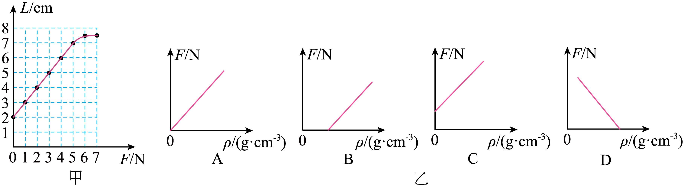

# Physics - 题目 358

**ID**: 1e08ba9bd4db45f18f482959c5ef4a7e
**年级**: Grade 8
**难度**: Medium-Hard
**题型**: Experiment

## 题目
小华在课外探究弹簧的伸长量与拉力F的关系，记录了实验数据，并根据数据得出了如图甲所示的图像（L为弹簧长度）。​​​​​​​‌（1）分析甲图，可得到的结论是：；（2）小华利用完全相同的小桶分别盛满三种液体，用该弹簧制成的测力计称出液体和小桶的总重力，记录的部分数据如下表：（ $ρ{{}_{酒精}}=0.8{\rm{g}}{\rm{/}}{\rm{c}}{\rm{m}}{^{3}}$ ）液体种类酒精水酱油弹簧测力计的示数F/N2.62.83.0①通过分析此表，小华发现了液体密度与弹簧测力计示数之间的关系．在图乙所示的图像中能正确反映这一关系的是（选填字母）；②试根据表中的数据计算出酱油的密度为${\rm{g}}{\rm{/}}{\rm{c}}{\rm{m}}{^{3}}$ ，小桶的重为N；（3）小华又利用该弹簧测力计及小桶，将弹簧测力计改装成可以直接读取液体密度的弹簧密度计（相邻刻度线的间隔为1mm），每次小桶装满液体．该弹簧密度计能测液体密度的最大值为${\rm{g}}{\rm{/}}{\rm{c}}{\rm{m}}{^{3}}$ ；其分度值为${\rm{g}}{\rm{/}}{\rm{c}}{\rm{m}}{^{3}}$ 。

## 解答

1. （1）分析图甲可知，从所给数据看：弹簧原长2cm，到7cm，在物体的重力在5N以前，钩码拉力增加弹簧的伸长量也增加，且成正比，故得结论：在弹性限度内，弹簧的伸长量跟所受拉力成正比。
2. （2）根据表格数据可知，液体的密度越大，测得液体和小桶的总重力越大，且不装入液体时，测力计的示数不为0（此时测力计测空桶的重）；结合图乙中的图像可知，只有C图像符合题意。
3. 由表格中数据知，称出水和小桶的总重力为2.8N，则
4. $G{{}_{桶}}+ρ{{}_{水}}Vg=G{{}_{1}}$
5. 即
6. $G{{}_{桶}}+1.0\times 10{^{3}}{\rm{k}}{\rm{g}}{\rm{/}}{\rm{m}}{^{{{3}}}}\times 10{\rm{N}}{\rm{/}}{\rm{k}}{\rm{g}}\times V=2.8{\rm{N}}$ ……①
7. 称出酒精和小桶的总重力为2.6N，且可酒精的密度为0.8g/cm^{3}，则
8. $G{{}_{桶}}+ρ{{}_{酒精}}Vg=G{{}_{2}}$
9. 即
10. $G{{}_{桶}}+0.8\times 10{^{3}}{\rm{k}}{\rm{g}}{\rm{/}}{\rm{m}}{^{{{3}}}}\times 10{\rm{N}}{\rm{/}}{\rm{k}}{\rm{g}}\times V=2.6{\rm{N}}$ ……②
11. ①-②解得
12. $V=10{^{-4}}{\rm{m}}{^{{{3}}}}\\G{{}_{桶}}=1.8{\rm{N}}$
13. 若小桶中盛满酱油时
14. $G{{}_{桶}}+ρ{{}_{酱油}}gV=G\prime $
15. 则酱油密度为
16. $ρ{{}_{酱油}}=\frac {G\prime -G{{}_{桶}}}{gV}=\frac {3.0{\rm{N}}-1.8{\rm{N}}}{10{\rm{N}}{\rm{/}}{\rm{k}}{\rm{g}}\times 10{^{-4}}m{^{3}}}=1.2\times 10{^{3}}{\rm{k}}{\rm{g}}{\rm{/}}{\rm{m}}{^{{{3}}}}=1.2{\rm{g}}{\rm{/}}{\rm{c}}{\rm{m}}{^{{{3}}}}$
17. （3）当桶内不加液体时，即相当于液体密度为0时，弹簧测力计的示数等于桶的重力1.8N，将弹簧测力计上1.8N刻度线延长，并标记为0g/cm^{3}；弹簧测力计的最大示数为5N，代入关系式
18. $G{{}_{总}}=G{{}_{桶}}+ρ{{}_{液}}gV$
19. 即
20. $5{\rm{N}}=1.8{\rm{N}}+ρ{{}_{液}}\times 10{\rm{N}}{\rm{/}}{\rm{k}}{\rm{g}}\times 1\times 10{^{-4}}{\rm{m}}{^{{{3}}}}$
21. 解得最大刻度处所对应的液体密度
22. $ρ{{}_{液}}=3.2\times 10{^{3}}{\rm{k}}{\rm{g}}{\rm{/}}{\rm{m}}{^{{{3}}}}=3.2{\rm{g}}{\rm{/}}{\rm{c}}{\rm{m}}{^{{{3}}}}$
23. 将弹簧测力计上5N刻度线延长，并标记为3.2g/cm^{3}。
24. 由图可知：根据图像每1N伸长1cm，1.8N～5.0N之间有3.2cm，相邻刻度线的间隔为1mm，共有32格，1N对应1cm，故该“密度秤”的分度值是
25. $\frac {3.2{\rm{g}}{\rm{/}}{\rm{c}}{\rm{m}}{^{{{3}}}}}{32}=0.1{\rm{g}}{\rm{/}}{\rm{c}}{\rm{m}}{^{{{3}}}}$

## 知识点

**中文**:
  - 探究弹簧测力计原理的实验
  - 特殊方法测密度

**English**:
  - Experiment: Principle of Spring Dynamometer
  - Special Methods for Measuring Density

---
