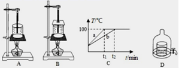
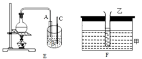

# Physics - 题目 58

**ID**: 22847923fe324690a381b6b71972051c
**年级**: Grade 8
**难度**: Medium-Hard
**题型**: Experiment

## 题目
如图在标准大气压下做“观察水的沸腾”的实验时，甲、乙、丙三个实验小组的同学分别从图中A、B两套实验装置中任选一套来完成实验。​​​​​​​‌（1）甲组同学从水温升高到90℃时开始记录数据，以后每隔1min记录一次水的温度，直到水沸腾5min为止。实验数据如表所示，分析表中的数据可知：甲组同学选择的是（选填“A”或“B”）套装置。时间01234567891011温度9092949698100101102102102102102（2）乙、丙两组同学都选择了另外一套实验装置，但他们绘制的沸腾图象却不同，如图C所示，其原因可能是不同（不定项选择）。

## 解答

1. （1）[1]如图，A装置烧杯上没有盖，B装置上烧杯有盖，烧杯上加盖，可以增大水上方的压强，使水的沸点升高，由表格数据知，水的沸点102℃，超过标准大气压下水的沸点100℃，则甲同学使用的是加盖的B装置。
2. （2）[2]由题意可知，乙、丙两组同学应都选择了装置A实验，由于装置A烧杯口没有加盖，因此液面上方气压相同；再由图乙可知，a、b图像中水的初温相同，从加热到沸腾所用的时间不同，原因可能是水的质量不同或加热时所用火焰位置不同造成的，故选CD。
3. （3）[3]抽气机抽气时，玻璃罩内的气压减小，根据沸点与大气压之间的关系可知，气压越低，沸点越低，所以抽出部分空气后玻璃罩内的气压减小，水的沸点降低，在不加热的情况下，水能重新沸腾。
4. （4）[4]图E中，烧瓶中水沸腾时产生的大量水蒸气进入试管A中，试管A放在装有冷水的容器B中，试管A的温度也比较低，通入试管A中的水蒸气受冷就会液化，形成小水珠，附着在试管壁上；水蒸气液化时要放出热量，所以温度计C的示数会升高。
5. （5）[5]图F中，甲容器口是密封的，乙试管口是敞开的。给甲容器加热，经过一段时间后，甲容器水面上的气压增大，大于1个标准大气压，沸点会高于100℃；乙容器的水从甲容器的水吸收热量，温度升高，当达到标准大气压下水的沸点100℃时就会沸腾，而此时甲容器的水还不能沸腾，经过一段时间后，甲容器的水达到沸点，也会沸腾，则乙容器中的水先沸腾，故选C。

## 知识点

**中文**:
  - 探究水的沸腾实验

**English**:
  - Experiment: Boiling of Water

---
