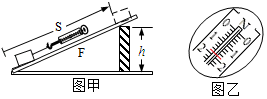

# Physics - 题目 2031

**ID**: 275d54706bdf4e6e9f84569773382d1e
**年级**: Grade 8
**难度**: Medium-Hard
**题型**: Experiment

## 题目
某班同学在“测量斜面的机械效率”实验时，所用实验器材有：长木板、支架、弹簧测力计、刻度尺、重力为5.4N木块（带挂钩）如图甲所示，将长木板和支架搭成长1.0m、高0.2m的斜面，用弹簧测力计沿斜面向上匀速拉动木块。​​​​​​​‌（1）如图乙所示，此时弹簧测力计对木块的拉力为N；（2）将木块匀速拉到斜面顶端，有用功为，总功为，斜面的机械效率为；（3）木块与斜面的摩擦力为N。

## 解答

1. （1）[1]由图知道，测力计分度值为0.2N，此时弹簧测力计对木块的拉力为1.8N。
2. （2）[2][3]根据题意知道，将木块匀速拉到斜面顶端，做的有用功和总功分别是
3. W有＝Gh＝5.4N×0.2m＝1.08J
4. W总=Fs=1.8N×1m=1.8J
5. [4]由 $η=\frac {W{{}_{有}}}{W{{}_{总}}}$ 知道，斜面的机械效率
6. $η=\frac {W{{}_{有}}}{W{{}_{总}}}\times 100{\rm{\%}}{\rm{=}}\frac {1.08{\rm{J}}}{1.8{\rm{J}}}\times 100{\rm{\%}}=60{\rm{\%}}$
7. （3）[5]将木块匀速拉到斜面顶端，则额外功
8. W额＝W总﹣W有＝1.8J-1.08J＝0.72J
9. 由W额＝fs知道，木块所受摩擦力
10. $f=\frac {W{{}_{额}}}{s}=\frac {{\rm{0}}{\rm{.}}{\rm{7}}{\rm{2}}{\rm{J}}}{{\rm{1}}{\rm{m}}}=0.72{\rm{N}}$

## 知识点

**中文**:
  - 斜面机械效率的测量实验

**English**:
  - Experiment: Measuring Mechanical Efficiency of Inclined Planes

---
