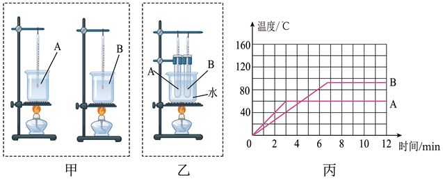

# Physics - 题目 2277

**ID**: 2ad57bffd9fa497d815d6266c909d78d
**年级**: Grade 8
**难度**: Medium-Hard
**题型**: Experiment

## 题目
某实验小组在“比较A、B液体谁更适合做发动机冷却剂”的实验中，他们设计了两种实验方案。​​​​​​​‌方案一：将质量相等、初温相同的甲、乙液体，分别装入两只规格相同的烧杯中，分别用两只酒精灯对烧杯加热，如图甲所示；方案二：将质量相等、初温相同的甲、乙液体，分别装入两只规格相同的试管中，再将两支试管放在盛有水的烧杯中，用酒精灯对烧杯加热，如图乙所示。实验小组经过讨论，选择方案二进行实验，观察实验现象，记录相关数据，并绘制出图像，如图丙所示。（1）他们一致认为方案二较好，因为该方案具有的优点。（答出一个即可）（2）从图像上可以看出：A液体的沸点是℃。（3）从图像上看，A液体的比热容（选填“大于”“小于”或“等于”）B液体比热容。（4）通过对实验结果的分析，可以知道：（选填“A”或“B”）液体更适合做汽车发动机的冷却液。

## 解答

1. （1）[1]方案二中，将两支试管放在盛有水的烧杯中，用酒精灯对烧杯加热，这样可以使得两支试管受热均匀。
2. （2）[2]从图像上可以看出，A液体当温度达到60℃后，温度不增加了，故A液体温度达到了沸点。
3. （3）[3]从图像可以看出，质量相等、初温相同的A、B液体，吸收相同的热量后，A升高的温度大于B升高的温度，由Q=cmΔt知，A液体的比热容小于B液体的比热容。
4. （4）[4]汽车发动机的冷却液选取比热容比较高的液体，通过结果对比，B液体更适合做冷却液。

## 知识点

**中文**:
  - 物质的比热容探究实验

**English**:
  - Experiment: Investigating Specific Heat Capacity

---
