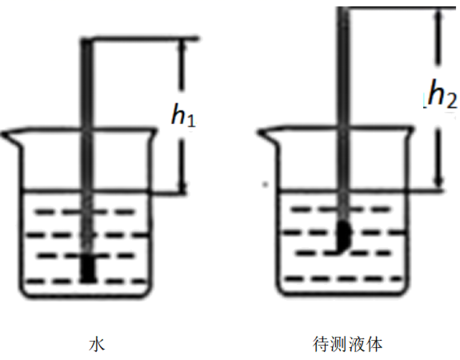
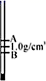

# Physics - 题目 2339

**ID**: 2af49c6a50e3416091f2df160a2635e0
**年级**: Grade 8
**难度**: Medium-Hard
**题型**: Experiment

## 题目
小静取一根圆柱形的饮料吸管，将一些铜丝从吸管的下端塞入作为配重，并用石蜡将吸管的下端封起来，初步做成一支密度计。​​​​​​​‌为了给密度计标上刻度，他用刻度尺测出密度计的总长度为H，然后将密度计放入水中，测出密度计露出水面的高度为 $h{{}_{1}}$ ；接着将该密度计放入待测液体中，密度计露出该液体表面的高度为 $h{{}_{2}}$ ，如图所示：(1)将一些铜丝从吸管的下端塞入作为配重目的是使吸管能在液体中；(2)利用测量的物理量和 $ρ{{}_{水}}$ ，计算待测液体的密度，请写出待测液体密度的表达式： $ρ{{}_{液}}=$；(3)将做成的密度计放入密度为0.9g/cm^{3}植物油中静止时，液面可能在图中（选填“A”或“B”）处，接着小静用刻度尺测出密度计1.0g/cm^{3}与0.9g/cm^{3}刻度线间的距离为0.80cm，则该密度计竖直漂浮时浸入水中的深度为cm；(4)小扬也用吸管制作了密度计，他发现密度计相邻两刻度线之间的距离太小，导致用此密度计测量液体密度时误差较大，为此同学们提出了如下改进方案，其中可行的是（）

## 解答

1. (1)将一些铜丝从吸管的下端塞入作为配重目的是使吸管能竖直漂浮在液体中，便于测量露出液面的高度。
2. (2)因密度计在液体中是漂浮的，故所受的浮力等于密度计的重力，即
3. $F{{}_{浮}}=G$
4. 故
5. $F{{}_{浮水}}=F{{}_{浮液}}$
6. 设吸管的底面积为S，则
7. $ρ{{}_{水}}gS\left ({H-h{{}_{1}}}\right )=ρ{{}_{液}}gS\left ({H-h{{}_{2}}}\right )$
8. 解得
9. $ρ{{}_{液}}=\frac {H-h{{}_{1}}}{H-h{{}_{2}}}\cdot ρ{{}_{水}}$
10. (3)因为
11. $ρ{{}_{油}}<ρ{{}_{水}}$
12. 且密度计在两液体中受到的浮力相等，由 $F{{}_{浮}}=ρ{{}_{液}}gV{{}_{排}}$ 可知
13. $V{{}_{排油}}>V{{}_{排水}}$
14. 故液面位置在水密度值刻度线的上方，即刻度0.9在A处。
15. 因密度计在液体中所受的浮力等于其重力，则有
16. $F{{}_{浮}}=ρ{{}_{液}}gV{{}_{排}}=ρ{{}_{液}}gSh{{}_{浸}}=G$
17. 即
18. $h{{}_{浸}}=\frac {G}{ρ{{}_{液}}gS}$
19. 设密度计1.0g/cm^{3}与0.9g/cm^{3}刻度线间的距离为 $h$
20. $V{{}_{油浸}}-V{{}_{水浸}}=h$
21. 即
22. $\frac {G}{ρ{{}_{油}}gS}-\frac {G}{ρ{{}_{水}}gS}=h$
23. 故
24. $\frac {G}{gS}=\frac {ρ{{}_{油}}ρ{{}_{水}}h}{ρ{{}_{水}}-ρ{{}_{油}}}=\frac {0.9\times 10{^{3}}{{\rm{k}}{\rm{g}}}/{{\rm{m}}{^{{\rm{3}}}}}\times 1.0\times 10{^{3}}{{\rm{k}}{\rm{g}}}/{{\rm{m}}{^{{\rm{3}}}}}\times 0.80\times 10{^{-2}}{\rm{m}}}{1.0\times 10{^{3}}{{\rm{k}}{\rm{g}}}/{{\rm{m}}{^{{\rm{3}}}}-}0.9\times 10{^{3}}{{\rm{k}}{\rm{g}}}/{{\rm{m}}{^{{\rm{3}}}}}}=72{{\rm{k}}{\rm{g}}}/{{\rm{m}}{^{{\rm{2}}}}}$
25. 则则该密度计竖直漂浮时浸入水中的深度为
26. $h{{}_{浸水}}=\frac {G}{ρ{{}_{水}}gS}=\frac {72{{\rm{k}}{\rm{g}}}/{{\rm{m}}{^{{\rm{2}}}}}}{1.0\times 10{^{3}}{{\rm{k}}{\rm{g}}}/{{\rm{m}}{^{{\rm{3}}}}}}=0.072{\rm{m}}=7.2{\rm{c}}{\rm{m}}$
27. (4)为了使测量结果更准确，应使简易密度计两条刻度线之间的距离大一些，可选用更细的吸管，横截面积小，体积相同时，液面的高度变化明显。
28. 故选C。

## 知识点

**中文**:
  - 密度计的原理及应用

**English**:
  - Principle and Application of Hydrometer

---
