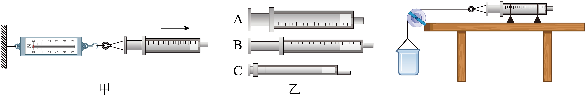

# Physics - 题目 2753

**ID**: 33c2ec84e29642ad8c93ec74f13b5cfb
**年级**: Grade 8
**难度**: Medium-Hard
**题型**: Experiment

## 题目
物理兴趣小组的同学利用周末开展一次登山活动，他们想利用随身携带的注射器、弹簧测力计、细线、刻度尺等相关用品测量山顶的大气压。​​​​​​​‌测量方案如下：

## 解答

1. （1）[1]如图，测出活塞的左侧受到大气压力，以及活塞的横截面积，既可以算出大气压强，即本试验分析研究的是大气对活塞的压力。
2. （2）[2]注射器顶端装针头处空气无法排尽，即有残余气体，注射器内还会有一定气压，这样会使拉力变小，在面积不变的情况下，由 $p=\frac {F}{S}$ 可知测出的大气压会偏小。
3. （3）[3][4]在活塞周围涂抹润滑油，通过减小接触面的粗糙程度来减小摩擦力，进而减小摩擦力对实验结果的影响；让弹簧测力计和注射器保持在水平方向，活塞在水平方向上就只受到水平向左的拉力和水平向右的大气压力，而活塞受到的重力竖直向下，避免了活塞的重力对实验结果的影响。
4. （4）[5][6]用图乙中B注射器在测量时，弹簧测力计被拉到5N，活塞仍没有滑动，说明大气压力过大，由 $F=pS$ 可知，可以换一个横截面积更小的注射器，以此来减小大气压力；由题可得，活塞的横截面积为 $S=\frac {V}{L}$ ，则大气压强为
5. $p=\frac {F}{S}=\frac {F}{\frac {V}{L}}=\frac {FL}{V}$
6. （5）[7]向烧杯中缓慢加水，当活塞刚开始向左滑动时，活塞在水平方向上的受力为
7. $F{{}_{大气}}{\rm{=}}F{{}_{拉左}}-f$
8. 当活塞刚开始向右滑动时，活塞在水平方向上的受力为
9. $F{{}_{大气}}{\rm{=}}F{{}_{拉右}}+f$
10. 则活塞左侧受到的大气压力为
11. $F{{}_{大气}}{\rm{=}}\frac {F{{}_{拉左}}+F{{}_{拉右}}}{2}$
12. 由题意得，活塞受到的拉力等于烧杯加水的总重力，则
13. $F{{}_{拉左}}=m{{}_{1}}g=（0.9{\rm{k}}{\rm{g}}+0.125{\rm{k}}{\rm{g}}）\times 10{\rm{N}}{\rm{/}}{\rm{k}}{\rm{g}}=10.25{\rm{N}}$
14. $F{{}_{拉右}}=m{{}_{1}}g=（0.5{\rm{k}}{\rm{g}}+0.125{\rm{k}}{\rm{g}}）\times 10{\rm{N}}{\rm{/}}{\rm{k}}{\rm{g}}=6.25{\rm{N}}$
15. 则
16. $F{{}_{大气}}{\rm{=}}\frac {F{{}_{拉左}}+F{{}_{拉右}}}{2}{\rm{=}}\frac {10{\rm{.}}25{\rm{k}}{\rm{g}}{\rm{+}}6{\rm{.}}25{\rm{k}}{\rm{g}}}{2}{\rm{=}}8{\rm{.}}25{\rm{N}}$
17. 则大气压强为
18. $p=\frac {F{{}_{大气}}}{S}{\rm{=}}\frac {8{\rm{.}}25{\rm{N}}}{7.5\times 10{^{-5}}{\rm{m}}{^{{\rm{2}}}}}{\rm{=}}1.1\times 10{^{5}}{\rm{P}}{\rm{a}}$

## 知识点

**中文**:
  - 大气压强的测量及标准大气压

**English**:
  - Measurement of Atmospheric Pressure & Standard ATM

---
