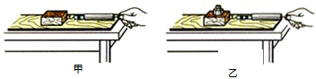

# Physics - 题目 1402

**ID**: 357496c26b14439887f061d886032912
**年级**: Grade 8
**难度**: Medium-Hard
**题型**: Experiment

## 题目
在“探究滑动摩擦力的大小与哪些因素有关”的实验中，同学们提出了以下几种猜想：(1)与压力的大小有关；(2)与物体运动的速度大小有关；(3)与物体间的接触面积大小有关；(4)与物体间接触面的粗糙程度有关。​​​​​​​‌实验室有一个较长且光滑程度一致的木板、一个带钩各侧面光滑程度一致的长方体木块，大砝码一个和一只弹簧测力计可供使用。小强同学用弹簧测力计拉动木块在水平放置的木板上进行三次实验，如图甲所示，然后将砝码放在木块上面又做了一次实验，如图乙所示。实验数据如下表（一）所示：表（一）次数木块放置方式木块运动快慢弹簧测力计示数1平放较慢1.2N2平放较快1.2N3侧放较慢1.2N4平放较慢1.6N(1)实验中弹簧测力计沿水平方向拉放在水平长木板上的木块做运动。弹簧测力计示数直接表示的大小，根据二力平衡条件，得出弹簧测力计示数与摩擦力的大小，拉力与摩擦力的方向；(2)表中数据1、2可以验证猜想（填序号）的正确或错误。此探究中控制变量是物体间接触面积和、；(3)根据表中数据1、4可以得到的结论是：。

## 解答

1. (1)[1][2][3][4]在“探究滑动摩擦力的大小与哪些因素有关”的实验中，物体受到的拉力通过弹簧测力计的示数来体现，要使物体受到的滑动摩擦力等于拉力，必须用弹簧测力计沿水平方向拉放在水平长木板上的木块做匀速直线运动，根据二力平衡条件，得出物体受到的拉力与摩擦力等大、反向、共线，弹簧测力计示数与摩擦力的大小相等。
2. (2)[5][6][7]实验数据1、2中，木块放置方式相同，即接触面积大小一样，且接触面粗糙程度相同，木板受到压力也相同，但木块运动快慢不一样，结果显示弹簧测力计读数相同，根据控制变量的原则分析可知，表中数据1、2可以验证猜想2是错误的，滑动摩擦力大小与物体运动速度无关。此探究中控制变量是物体间接触面积、压力的大小和接触面的粗糙程度。
3. (3)[8]实验数据1、4中，木块放置方式相同，即接触面积大小一样，且接触面粗糙程度相同。数据1利用图甲进行实验，数据4利用图乙进行实验，说明两次实验水平面受到的压力不同，数据4中压力大于数据1，结果显示，数据4中弹簧测力计的读数大于数据1中弹簧测力计读数，即转换出数据4中木块受到的滑动摩擦力大于数据1中木块受到的滑动摩擦力。故可得出结论，在接触面粗糙程度相同的情况下，滑动摩擦力的大小与压力有关，压力越大，滑动摩擦力越大。

## 知识点

**中文**:
  - 影响滑动摩擦力大小因素的探究实验

**English**:
  - Experiment: Factors Affecting Sliding Friction

---
