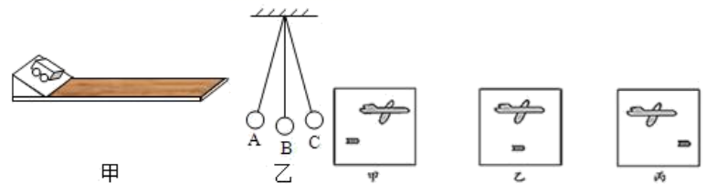

# Physics - 题目 1724

**ID**: 36394aa7deae4a05867e1d38e62b988a
**年级**: Grade 8
**难度**: Medium-Hard
**题型**: Experiment

## 题目
在探究“阻力对物体运动的影响”实验中，在水平木板上先后铺上粗糙程度不同的毛巾和棉布让小车从斜面顶端由静止滑下，如图甲所示，观察和比较小车在毛巾表面、棉布表面和木板表面滑行的距离。​​​​​​​‌（1）实验中每次均让小车从斜面顶端由静止滑下的目的是：。（2）实验中是通过改变来改变小车所受阻力大小的。（3）实验中发现：小车在毛巾表面上滑行的距离最短，在木板上滑行的距离最远，说明小车受到的阻力越小，速度减小得越（选填“快”或“慢”）。（4）在此基础上，牛顿总结了伽利略等人的研究成果，概括出牛顿第一定律，请问：牛顿第一定律（选填“能”或“不能”）直接由实验得出。（5）通过上面的探究后，小明又思考如下的问题：如图乙所示，摆球从A点由静止释放摆到右侧最高点 $C$ 时，如果摆球所受的力忽然全部消失，则摆球将（选填“往回摆”“静止”或“做匀速直线运动”）。（6）在大量类似实验基础上，牛顿等科学家经过进一步推理而概括出了著名的牛顿第一定律。它是人们公认的物理学基本定律之一，在实际生活中有着广泛的应用：一架在空中水平向右匀速直线飞行的飞机上，自由落下了一颗炸弹。下列给出了几种炸弹落地前与飞机位置关系的情形，如图所示。请你认真分析后作出正确的选择：①不计空气对炸弹的阻力，炸弹与飞机的位置关系为图。②实际上，由于空气阻力的存在，炸弹与飞机的位置关系为图。

## 解答

1. （1）该实验应使小车运动到斜面底端时的速度相等，比较小车运动的距离才有意义，所以要控制小车每次都从斜面上同一位置释放。
2. （2）在做“斜面小车实验”时，给水平桌面铺上粗糙程度不同的物体，目的是探究阻力对物体运动的影响，由毛巾表面到棉布再到木板，接触面的粗糙程度减小，小车受到的阻力也减小。
3. （3）表面越光滑，阻力就越小，小车运动的距离就越远，这说明小车受到的阻力越小，速度减小得越慢。
4. （4）牛顿第一定律是在实验的基础上，通过推理得出的，不能用实验直接得出的。
5. （5）当摆球从A点由静止释放摆到右侧最高点C时，此时小球的动能全部转化为重力势能，速度为零，若不受任何外力，根据牛顿第一定律，将保持静止状态不变。
6. （6）不计空气对炸弹的阻力，在水平方向上，炸弹与飞机的速度相等，它们相对静止，由图示可知，炸弹与飞机的位置关系为乙图。
7. 实际上，由于空气阻力的存在，在水平方向上，炸弹由于受到空气阻力作用，速度小于飞机速度，由图示可知，炸弹与飞机的位置关系为甲图。

## 知识点

**中文**:
  - 阻力对物体运动影响的探究实验

**English**:
  - Experiment: Effect of Resistance on Motion

---
