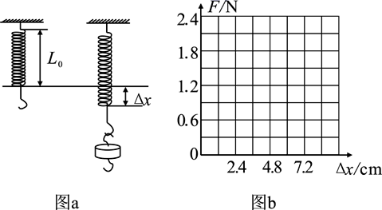
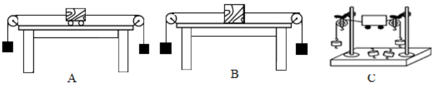
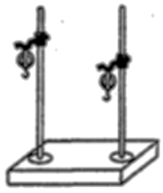

# Physics - 题目 1085

**ID**: 36eb80d6c4734303be9ad59452ef72fa
**年级**: Grade 8
**难度**: Medium-Hard
**题型**: Experiment

## 题目
小华为研究弹簧的性质，在竖直悬挂的弹簧下加挂钩码（如图a），同时记录弹簧总长度L与钩码质量m，所得数据记录在表一中．已知弹簧原长L_{0}＝6.0 cm.实验过程中，弹簧形变在弹性限度内，不计弹簧所受的重力。​​​​​​​‌（g取10 N/kg）表一：实验次数123456钩码质量m/g0306090120150弹簧总长度L/cm6.07.28.49.610.812.0表二：实验次数123456弹力F/N00.3①0.91.21.5弹簧伸长量 ${\rm{Δ}}$x/cm01.22.43.6②6.0（1）根据表一中的数据，将表二填写完整，①，②；（2）请在图b坐标系中描点作出弹力F跟弹簧伸长量 ${\rm{Δ}}$x的关系图象；（3）分析表二中的数据能得出的结论是，这就是弹簧测力计的工作原理。于是他又找来纸板标上刻度自制了一个弹簧测力计；（4）利用以上实验器材你认为还可以探究什么问题；（5）如图甲所示，小华认为，利用以上器材还可以研究二力平衡的条件，测出物体所受的和的大小来进行比较。小明研究后表示反对，这个装置只能根据相互作用的关系直接测出其中一个力的大小，在未知二力平衡条件的前提下，无法直接测量，所以这一方案无法实施下去；（6）为此，两位同学不断改进并先后设计了三个实验方案，如图所示，请你判断出她们改进的先后顺序：（用字母表示）；（7）小华将系于小卡片（重力可忽略不计）两端的线分别跨过左右支架上的滑轮，在线的两端挂上钩码，使作用在小卡片上的两个拉力方向，并通过调整来改变拉力的大小；（8）当小卡片平衡时，小华将小卡片转过一个角度，松手后小卡片（能／不能）平衡；（9）小红同学也对同一问题进行了探究，但他在左右支架上装配两个滑轮时没有安装成相同高度（如图所示），你认为能否用小红的装置进行实验（能/不能）。

## 解答

1. (1)[1]由题意可知，弹簧所产生的弹力，等于钩码所受的重力，根据表一中的数据，表二中，第3次的弹力
2. F=G=mg=0.06kg×10N/kg=0.6N
3. 故①处为0.6。
4. [2]第5次的弹簧伸长量
5. ${\rm{Δ}}$x′=10.8cm−6.0cm=4.8cm
6. 故②处为4.8。
7. (2)[3]根据表二中的数据，先画点，再描线，见下图：
8. 
9. (3)[4]分析表二中的数据可知， $\frac {F}{{\rm{Δ}}x}$ = $\frac {1}{4}$ ，即弹力与弹簧伸长量的比值是定值，故得出的结论是在弹性限度内，弹力的大小与弹簧伸长量成正比，这就是弹簧测力计的工作原理。
10. (4)[5]利用弹簧测力计可测物体的重力，因此利用弹簧测力计和钩码还可以探究重力与质量的关系。
11. (5)[6][7][8] 若采用小华的方案，必须测出物体所受的拉力和重力的大小来进行比较；研究发现，在小华的方案中，只能根据相互作用的关系直接测出拉力的大小，在未知二力平衡条件的前提下，另一个力(重力)无法直接测量，所以这一方案无法实施下去。
12. (6)[9]B图为滑动摩擦，A图为滚动摩擦，C图只有滑轮与绳子间的摩擦，其中滑动摩擦最大、滑轮与绳子间的摩擦最小，所以他们改进的先后顺序为：B、A、 C；这样的改进是为了减小摩擦力对实验的影响。
13. (7)[10][11]小卡片两端通过滑轮各挂一个钩码，两个钩码通过绳子对小卡片施加了两个向相反方向的拉力，拉力的大小等于钩码的重力，钩码的数量越多，拉力就越大，即调整钩码个数来改变拉力的大小。
14. (8)[12]小卡片转过一个角度，小卡片两端的拉力就不在一条直线上，纸片就会转动，说明了不在同一直线上的两个力不能平衡。
15. (9)[13]两个滑轮安装的高度不相同时，二力的大小不变，方向仍然相反，且在同一直线上，故不会影响实验结论。

## 知识点

**中文**:
  - 二力平衡条件的探究实验
  - 探究弹簧测力计原理的实验

**English**:
  - Experiment: Conditions for Two-Force Equilibrium
  - Experiment: Principle of Spring Dynamometer

---
