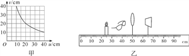

# Physics - 题目 2908

**ID**: 383f74c3b136402abc93054171575adb
**年级**: Grade 8
**难度**: Medium-Hard
**题型**: Experiment

## 题目
小明同学做“探究凸透镜成像规律”的实验，他根据收集的数据作出如图甲所示的图像：(1)由图像可知，小明同学使用的凸透镜的焦距为cm．(2)当蜡烛放置在光具座上的45cm刻度处时，小明应该如何观察烛焰的像？(3)实验过程中，保持蜡烛和凸透镜的位置不变，调皮的明明把近视眼镜放在凸透镜和蜡烛之间，如图乙所示，小明发现光屏上烛焰的像变模糊了，此时他应该把光屏向（选填“靠近”或“远离”)透镜的方向移动，才能得到清晰的烛焰的像．​​​​​​​‌

## 解答

1. (1)由图象可知，u=v=2f=20cm，所以凸透镜的焦距是10cm；(2)当蜡烛放置在光具座上的45cm刻度处时，有图可知此时u=5cm 物体处于1倍焦距以内，故此时应该在凸透镜的右侧通过凸透镜向左观察，能看到一个正立、放大的虚像；
2. (3)近视眼镜是凹透镜，由于凹透镜对光线有发散作用，所以当小明把自己的近视眼镜靠近凸透镜时，像会聚在光屏的后方，这样像距会增大，因此在光屏上要得到清晰的像，应把光屏向远离透镜的方向移动．
3. 故答

## 知识点

**中文**:
  - 凸透镜成像规律的探究实验

**English**:
  - Experiment: Imaging Rules of Convex Lenses

---
