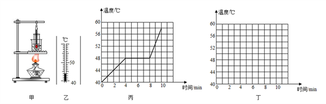

# Physics - 题目 655

**ID**: 3afc8dd667004b91814f4d4c933f7087
**年级**: Grade 8
**难度**: Medium-Hard
**题型**: Experiment

## 题目
如图甲是“探究固体熔化和凝固的特点”的实验装置。​​​​​​​‌(1)将适量的固体装入试管，温度计的玻璃泡要完全包裹在固体中，且不碰到容器壁和。本实验采用“水浴法”对固体加热，目的是使固体受热。除图甲所示实验器材外，还需要的实验器材有火柴和。(2)对水加热并从40℃开始，每隔1min记录一次温度，某时刻温度计的示数如图乙所示，则此时温度计的读数为℃。根据数据描绘出图像内，可知该物质是（选填“晶体”或“非晶体”），熔化时温度为℃。若第5分钟时将试管从水中取出，固体停止熔化。再放回水中，固体又继续熔化，说明固体熔化需要。(3)当固体全部熔化为液体后，取出试管自然冷却，每隔1min记录一次温度如下表，请你根据下列数据在丁图中画出液体凝固时的温度—时间图像。（）对比丙、丁图像，发现该物质熔化和凝固过程中的共同特点是。时间/min01234567891011温度/℃565350484848484847454341

## 解答

1. (1)[1]温度计使用时需要将玻璃泡全部浸没在被测液体中，不能碰烧杯底和烧杯壁。
2. [2]给物体加热时用水浴法，可以使物体受热均匀。
3. [3]除图甲所示实验器材外，还需要的实验器材有火柴和计时工具钟表。
4. (2)[4]由图乙可知，温度计的分度值为1℃，所以温度计读数为44℃.
5. [5][6]根据图像丙可知，该物质吸热升温到一定温度时，继续吸热，但是温度保持不变，即该物质有固定的熔点，所以该物质为晶体；熔化时固定不变的温度为48℃。
6. [7]若第5分钟时将试管从水中取出，固体停止熔化。再放回水中，固体又继续熔化，说明固体熔化需要继续吸收热量。
7. (3)[8]根据表中数据描点画图
8. 
9. [9]对比丙、丁图像，发现该物质熔化和凝固过程中的共同特点是，在48℃时温度保持不变，即同种物质的熔点和凝固点相同。

## 知识点

**中文**:
  - 熔化和凝固的探究实验

**English**:
  - Experiment: Melting and Solidification

---
