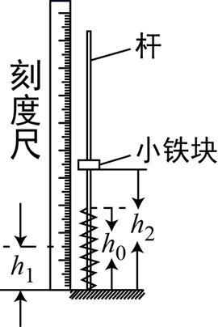
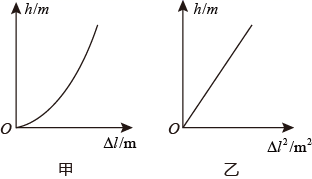

# Physics - 题目 639

**ID**: 3e1121edfc4a499ea656d9c3afad5714
**年级**: Grade 8
**难度**: Medium-Hard
**题型**: Experiment

## 题目
在“探究弹簧弹性势能大小与形变量的关系”时，某实验小组同学提出两种猜想。​​​​​​​‌猜想一：“弹簧弹性势能大小可能与弹簧的弹性形变量成正比”；猜想二：“弹簧弹性势能大小可能与弹簧的弹性形变量的平方成正比”。为了验证猜想他们用如图所示装置进行实验，弹簧套在光滑竖直杆上且底端固定在水平面上，刻度尺与杆平行， 主要实验步骤如下：①弹簧处于自由状态时，读出其上端对应刻度尺的高度为h_{0}，记录数据。②将中间有孔的小铁块套在光滑竖直杆上放于弹簧上端，并竖直向下按压小铁块，读出此时弹簧上端对应刻度尺的高度为h_{1}，记录数据。③释放小铁块使弹簧恢复原长，当小铁块上升到最大高度时，读出小铁块下端对应刻度尺的高度为h_{2}，记录数据。④改变弹簧的压缩长度，仿照步骤②和③，记录数据，并计算弹簧的形变量Δl、形变量的平方Δl^{2}和小铁块上升的距离h。请回答下列问题：（1）实验中弹簧的形变量Δl=（用所测物理量符号表示）。（2）小铁块上升的距离h可以间接反映弹簧的大小。（3）该小组同学根据实验数据分别做出h—Δl和h—Δl^{2}的图像，如图所示，由此得到的结论是：同一个弹簧，其弹性势能的大小与成正比。

## 解答

1. 弹簧的形变量等于弹簧的原长与被压缩后的长度之差，所以实验中弹簧的形变量Δl=h_{0}－h_{1}。
2. 实验中将弹簧压缩，发生弹性形变的弹簧具有弹性势能，释放小铁块，弹簧将小铁块向上弹起，弹簧的弹性势能转换为铁块的重力势能，使铁块上升，弹簧具有的弹性势能越大，小铁块上升的距离越大，所以小铁块上升的距离h可以间接反映弹簧的弹性势能的大小。
3. 分析甲、乙两图可知，乙图为正比例函数图像，乙图中两个变量成正比，由此得出结论：同一个弹簧，其弹性势能的大小与Δl^{2}成正比。

## 知识点

**中文**:
  - 弹性势能

**English**:
  - Elastic Potential Energy

---
