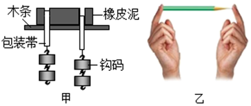

# Physics - 题目 2201

**ID**: 3fa1c4d44f6d4ec4804c70ff1bf02bc8
**年级**: Grade 8
**难度**: Medium-Hard
**题型**: Experiment

## 题目
在“探究压力的作用效果跟什么因素有关”的实验中，小华同学利用木条、橡皮泥、包装带和钩码进行探究活动。​​​​​​​‌〖设计并进行实验〗（1）如图甲所示，将橡皮泥做成长方体平放于木条上方，把包装带撕成不同宽度的两段，各自首尾相接，并在连接处挂上相同数量的钩码，分别将包装带套在橡皮泥的不同位置，小华同学通过观察橡皮泥的不同，初步分析得出结论：在相同时，，压力作用效果越明显；（2）小华想探究压力作用效果跟压力大小的关系，应进行的操作是：将橡皮泥恢复原状，把包装带撕成宽度的两段，两包装带下方挂数量的钩码，观察橡皮泥的变化；（均选填“相同”或“不同”）〖评估〗（3）小欣同学认为小华的实验还不足以支撑实验结论，于是她用铅笔作为实验器材进行了探究活动，如图乙所示，发现压笔尖端的手指较痛，同样得出上述步骤（1）的结论。继续增大压铅笔的力，手指感觉更痛，从而得出在相同时，，压力作用效果越明显。

## 解答

1. （1）[1]实验过程中，小华同学是通过观察橡皮泥凹陷的程度来比较压力作用效果的，这是转换法。
2. [2][3]由图甲实验可知，压力大小相同，包装带宽度不相同，橡皮泥的形变不相同且越窄的包装带，橡皮泥形变越厉害，故可得出结论：在压力大小相同时，受力面积越大，压力的作用效果越明显。
3. （2）[4][5]要探究压力作用效果与压力大小的关系，应使受力面积相同，压力大小不相同，故应把包装带撕成相同宽度的两段，两包装带下方挂不同数量的钩码，观察橡皮泥的变化。
4. （3）[6][7]铅笔处于静止状态，所以两侧手指受到的压力大小相同，由于两侧受到面积的大小不同，所以压力的作用效果不同，继续增大压铅笔的力，受力面积不变，手指感觉更痛，从而得出在受力面积相同时，压力越大压力作用效果越明显。

## 知识点

**中文**:
  - 探究影响压力作用效果因素的实验

**English**:
  - Experiment: Factors Affecting Pressure Effect

---
