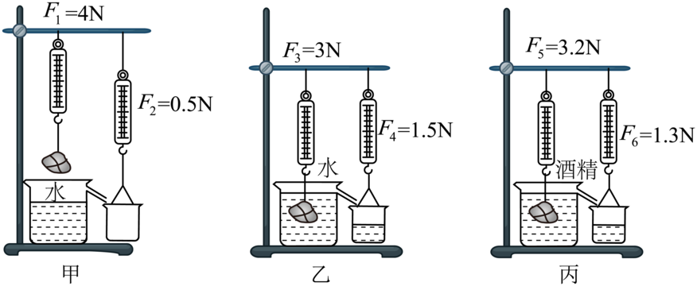
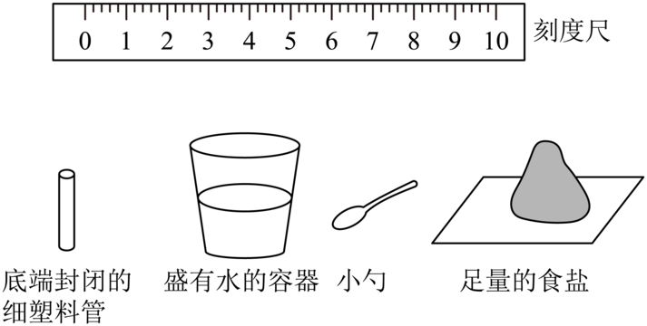

# Physics - 题目 1636

**ID**: 43704d8b8eca4eb5aaad26dfac6089a7
**年级**: Grade 8
**难度**: Medium-Hard
**题型**: Experiment

## 题目
兴趣小组利用弹簧测力计、物块、溢水杯、小桶、铁架台等器材验证阿基米德原理。​​​​​​​‌（细线的质量和体积均忽略不计）（1）实验中所用物块的重力为N；（2）同学们发现溢水杯中未装满水，如图甲所示，这样实验会使测得的溢出水的重力；（3）溢水杯装满水后，将物块浸没在水中，如图乙所示，物块受到的浮力为N。物块受到的浮力大小与它排开水所受的重力大小；（4）继续多组实验，将物块浸没在装满酒精的溢水杯中，如图丙所示，发现  $F{{}_{5}}>F{{}_{3}}$ 。说明物块受到的浮力大小与有关，换用酒精再次实验的目的是。（5）利用上述数据，计算出物块的密度为kg/m^{3}。（6）学习了浮力的相关知识后，小沈想用家中可用器材（如图所示），测出一枚新鲜鸡蛋的密度。已知水的密度为ρ_{水}，设计一个测量鸡蛋密度的实验方案如下：①用刻度尺测出塑料管的长度为L_{0}；②将装有适量盐的塑料管竖直漂浮在水中，测出塑料管露出液面的长度为L_{1}；③将鸡蛋放入水中，此时鸡蛋（选填“漂浮”或“沉底”），向水中加盐使鸡蛋悬浮，再测出塑料管露出液面的长度为L_{2}；写出鸡蛋密度的数学表达式ρ_{鸡蛋}=（用物理量符号表示）。

## 解答

1. （1）由图甲可知，物块未浸入水中时，弹簧测力计的示数为4N，因此物块的重力为4N。
2. （2）若溢水杯中未装满水，如图甲所示，则物块开始浸入时，水不会溢出，所以这样实验会使测得的溢出水的重力偏小。
3. （3）将物块浸没在水中，如图乙所示，根据称重法可知，物块受到的浮力为F_{浮}=G-F_{3}=4N-3N=1N
4. 由图甲和图乙可知，物块排开水的重力为G_{排}=F_{4}-F_{2}=1.5N-0.5N=1N
5. 则F_{浮}=G_{排}，所以物块受到的浮力大小与它排开水所受的重力大小相等。
6. （4）将物块浸没在酒精中，如图丙所示，根据称重法可知，物块受到的浮力为F_{浮酒精}=G-F_{5}=4N-3.2N=0.8N
7. 物块在水中和酒精中排开液体的体积相同，液体的密度不同，受到的浮力不同，因此可知说明物块受到的浮力大小与液体的密度有关。
8. 在验证阿基米德原理的实验中，换用不同的液体多次实验，比较F_{浮}和G_{排}的关系，可以避免偶然性，使实验结论更具普遍性。
9. （5）由（3）可知，物块完全浸没在水中时，受到的浮力为1N，根据阿基米德原理可知，物块的体积为 $V=V{{}_{排}}=\frac {F{{}_{浮}}}{ρ{{}_{水}}g}=\frac {1{\rm{N}}}{1\times 10{^{3}}{{\rm{k}}{\rm{g}}}/{{\rm{m}}{^{3}}\times 10{{\rm{N}}}/{{\rm{k}}{\rm{g}}}}}=1\times 10{^{-4}}{\rm{m}}{^{3}}$
10. 则物块的密度为 $ρ{{}_{物}}=\frac {m}{V}=\frac {G}{gV}=\frac {4{\rm{N}}}{10{{\rm{N}}}/{{\rm{k}}{\rm{g}}\times 1\times 10{^{-4}}{\rm{m}}{^{3}}}}=4\times 10{^{3}}{{\rm{k}}{\rm{g}}}/{{\rm{m}}{^{3}}}$
11. （6）由于鸡蛋的密度大于水的密度，由浮沉条件可知，将鸡蛋放入水中，此时鸡蛋沉底。
12. 设塑料管的横截面积为S， 塑料管排开水的体积V_{排管}=S(L_{0}-L_{1})
13. 受到水的浮力F_{浮水}=ρ_{水}V_{排管}g=ρ_{水}S(L_{0}-L_{1})g
14. 因为塑料管漂浮，所以塑料管（包括管内盐）的重力G=F_{浮水}=ρ_{水}S(L_{0}-L_{1})g
15. 将鸡蛋放入水中，向水中加盐使鸡蛋悬浮，此时塑料管受到盐水的浮力F_{浮盐水}=ρ_{盐水}V_{排}_{1}g=ρ_{盐水}S(L_{0}-L_{2})g
16. 因为塑料管漂浮，则F_{浮盐水}=G=F_{浮水}
17. 则ρ_{盐水}S(L_{0}-L_{2})g=ρ_{水}S(L_{0}-L_{1})g
18. 解得盐水的密度为 $ρ{{}_{盐水}}=\frac {L{{}_{0}}-L{{}_{1}}}{L{{}_{0}}-L{{}_{2}}}ρ{{}_{水}}$
19. 因为鸡蛋悬浮盐水中，所以鸡蛋的密度等于盐水的密度，即 $ρ{{}_{鸡蛋}}=ρ{{}_{盐水}}=\frac {L{{}_{0}}-L{{}_{1}}}{L{{}_{0}}-L{{}_{2}}}ρ{{}_{水}}$

## 知识点

**中文**:
  - 利用浮力知识测密度
  - 实验探究阿基米德原理

**English**:
  - Measuring Density using Buoyancy
  - Experiment: Investigating Archimedes' Principle

---
