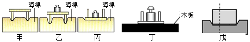

# Physics - 题目 577

**ID**: 475e9978edbf4b0a9b08634eb17e2a6e
**年级**: Grade 8
**难度**: Medium-Hard
**题型**: Experiment

## 题目
小明利用小桌、海绵、砝码等探究影响压力作用效果的因素，如甲，乙、丙所示。​​​​​​​‌(1)如图中是通过观察来比较压力作用效果的；(2)通过比较图甲和图乙，说明，压力的作用效果越明显；(3)通过比较图，说明压力一定时，受力面积越小，压力的作用效果越明显；(4)将该小桌和砝码放在如图丁所示的木板上，分析丙中海绵受到的压强p和图丁中木板受到的压强 $p^{′}$ 的大小关系为p$p^{′}$ ；（填“>”“<”或“=”）(5)实验时，如果将小桌换成砖块，并将砖块延竖直方向切成大小不同的两块，如图戊所示，小明发现他们对海绵的压力作用效果相同，由此得出的结论是压力的作用效果与受力面积无关。此结论是否正确，原因是。

## 解答

1. (1)[1]探究影响压力作用效果的因素的实验，是利用转换法通过观察海绵的凹陷程度来比较压力作用效果的。
2. (2)[2]比较图甲和图乙，发现受力面积相同，受到压力大的海绵凹陷程度大一些，说明在受力面积相同时，压力越大，压力的作用效果越明显。
3. (3)[3]通过比较图乙和图丙，发现海绵受到的压力相同时，受力面积越小，海绵的凹陷程度越大，说明压力一定时，受力面积越小，压力的作用效果越明显
4. (4)[4]图丙和丁，压力大小相同，受力面积相同，由 $p=\frac {F}{S}$ 可知，两者压强相同，即
5. $p=p^{′}$
6. (5)[5][6] ]图戊，将小桌换成砖块，并将砖块沿竖直方向切成大小不同的两块，由于没有控制压力大小相同，所以不能得出：压力的作用效果与受力面积无关。

## 知识点

**中文**:
  - 探究影响压力作用效果因素的实验

**English**:
  - Experiment: Factors Affecting Pressure Effect

---
