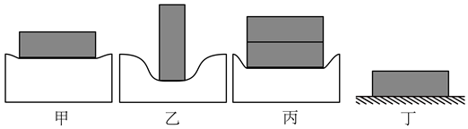

# Physics - 题目 1642

**ID**: 497ac47ddc0445e39be9719cc9c6f791
**年级**: Grade 8
**难度**: Medium-Hard
**题型**: Experiment

## 题目
在探究“压力的作用效果与压力大小、受力面积的关系”实验中：（1）实验用沙的凹陷来表示的作用效果；（2）通过甲和实验能够得到的结论是受力面积一定时，压力，压力的作用效果越明显。​​​​​​​‌和实验能够说明压力相同时，受力面积，压力作用效果越明显；（3）比较甲、乙、丙、丁四次实验，物体对接触面产生的压强相等的是和。

## 解答

1. （2）[2]压力的作用效果与受力面积及压力的大小有关，在保持受力面积相同时，应改变压力的大小，从而探究压力作用效果与压力大小的关系。所以可通过甲和丙两个实验来验证。
2. [3]图丙中物体对沙的压力比图甲中的大，沙的凹陷程度更明显，那么在受力面积一定时，压力越大，压力的作用效果越明显。
3. [4][5]在保持压力相同时，应让受力面积不同，便可探究压力作用效果与受力面积的关系，所以可通过甲、乙两个实验来验证。
4. [6]甲、乙两个实验中，乙与沙的接触面更小，沙的凹陷程度更明显，这说明，压力相同时，受力面积越小，压力的作用效果越明显。
5. （3）[7][8]甲、丁实验中，物体对接触面的压力相同，受力面积相同，则压力的作用效果相同，即物体对接触面产生的压强相等，只是甲、丁中，接触面发生形变的难易程度不同，所以物体对接触面的形变程度看起来不同。

## 知识点

**中文**:
  - 探究影响压力作用效果因素的实验

**English**:
  - Experiment: Factors Affecting Pressure Effect

---
