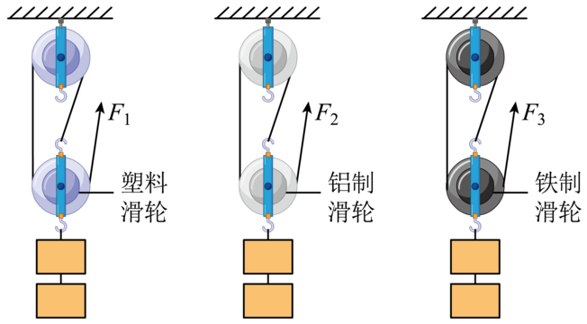

# Physics - 题目 1437

**ID**: 49e01f5f268549e19f84e5fd9f26aa6e
**年级**: Grade 8
**难度**: Medium-Hard
**题型**: Experiment

## 题目
用如图所示的装置按顺序依次做“探究滑轮组机械效率和哪些因素有关”的实验：（已知ρ_{塑料}<ρ_{铝}<ρ_{铁}）（1）实验时在三个装置上分别挂上相同的钩码，并且用力拉绳使钩码上升；（2）实验时不考虑绳重及摩擦，塑料滑轮、铝制滑轮及铁制滑轮外形相同、材质不同，则拉力F_{1}、F_{2}、F_{3}的大小关系是；机械效率η_{1}、η_{2}、η_{3}的大小关系是；（3）若每个钩码重5N，铝制滑轮的重力为2N，将钩码匀速提升20cm，不计绳重和摩擦，该铝制滑轮组的机械效率为。​​​​​​​‌

## 解答

1. （1）[1]并且用力拉绳使钩码匀速上升，只有处于钩码平衡态，才能够分析受力。
2. （2）[2][3]都是3段绳子分担动滑轮重，故拉力F_{1}、F_{2}、F_{3}的大小关系是
3. $F=\frac {1}{3}\left ({G{{}_{物}}+G{{}_{动}}}\right )$
4. 根据ρ_{塑料}<ρ_{铝}<ρ_{铁}可知，外形相同，即体积相同，则塑料滑轮的重力最小，铝滑轮的重力稍微大一点，而铁制滑轮重是最大的，故
5. $F{{}_{1}}<F{{}_{2}}<F{{}_{3}}$
6. 机械效率η_{1}、η_{2}、η_{3}的大小关系
7. $η=\frac {W{{}_{有}}}{W{{}_{总}}}\times 100{\rm{\%}}{\rm{=}}\frac {G{{}_{物}}h}{G{{}_{物}}h+G{{}_{动}}h}\times 100{\rm{\%}}{\rm{=}}\frac {G{{}_{物}}}{G{{}_{物}}+G{{}_{动}}}$
8. 塑料滑轮的重力最小，铝滑轮的重力稍微大一点，而铁制滑轮重是最大的，故机械效率的大小关系为
9. $η{{}_{1}}>η{{}_{2}}>η{{}_{3}}$
10. （3）[4]该铝制滑轮组的机械效率为
11. $η=\frac {W{{}_{有}}}{W{{}_{总}}}\times 100{\rm{\%}}{\rm{=}}\frac {G{{}_{物}}h}{G{{}_{物}}h+G{{}_{动}}h}\times 100{\rm{\%}}{\rm{=}}\frac {G{{}_{物}}}{G{{}_{物}}+G{{}_{动}}}{\rm{=}}\frac {5{\rm{N}}\times 2}{5{\rm{N}}\times 2{\rm{+}}2{\rm{N}}}{\rm{=}}83{\rm{.}}3{\rm{\%}}$

## 知识点

**中文**:
  - 滑轮组及其工作特点
  - 滑轮（组）的机械效率及其计算

**English**:
  - Pulley Systems and Operating Characteristics
  - Mechanical Efficiency of Pulleys and Calculations

---
