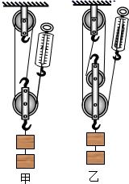

# Physics - 题目 2412

**ID**: 49ef10cc51b2486b8529a9e49a8c33c3
**年级**: Grade 8
**难度**: Medium-Hard
**题型**: Experiment

## 题目
某实验小组在测滑轮组机械效率的实验中得到的数据如表所示，实验装置如图所示。​​​​​​​‌实验次数物理量123钩码重G/N446钩码上升高度h/m0.10.10.1绳端拉力F/N1.81.62.4绳端移动距离s/m0.30.4机械效率η74.1%62.5%（1）实验中应沿竖直方向拉动弹簧测力计，使钩码上升。（2）通过表中数据可分析出第 2 次实验是用（选填“甲”或“乙”）图所示装置做的实验。（3）通过第 1 次实验和第 2 次实验的数据分析可得出结论：使用不同的滑轮组提升相同的重物时，动滑轮的个数越多（动滑轮的质量越大），滑轮组的机械效率（选填“越高”、“不变”或“越低”）。（4）小组同学再用第1次实验中使用的装置做第3次试验，表中第3次试验中空缺的数据应为：绳端移动距离s=m，机械效率η=。（5）比较第 1 次实验和第 3 次实验可得出结论：。

## 解答

1. （1）[1]实验中应沿竖直方向匀速拉动弹簧测力计，使钩码上升。
2. （2）[2]根据s=nh可知，第二次实验中，n=4，因此选择乙装置进行实验。
3. （3）[3]由表中第 1 次实验和第 2 次实验的数据可知，使用不同的滑轮组提升相同的重物时，动滑轮的个数越多（ 动滑轮的质量越大），滑轮组的机械效率越低。
4. （4）[4][5][6]由表中第 1 次实验数据可知，绳端移动的距离是钩码上升高度的3倍，第三次实验使用同样的装置，因此都使用了甲装置。
5. 则第3次实验：绳端移动距离
6. s=3h=3×0.1m=0.3m
7. 机械效率
8. η=  $\frac {W{{}_{有}}}{W{{}_{总}}}$ = $\frac {Gh}{Fs}$ = $\frac {6{\rm{N}}\times 0.1{\rm{m}}}{4{\rm{N}}\times 0.3{\rm{m}}}$ ≈83.3%
9. （5）[7]由表中第 1 次实验和第 3 次实验数据可知：使用同一滑轮组，提升的重物越重，滑轮组的机械效率越高。

## 知识点

**中文**:
  - 滑轮（组）的机械效率的测量实验

**English**:
  - Experiment: Measuring Mechanical Efficiency of Pulleys

---
