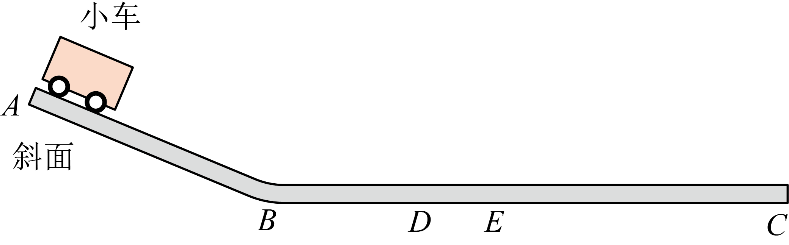
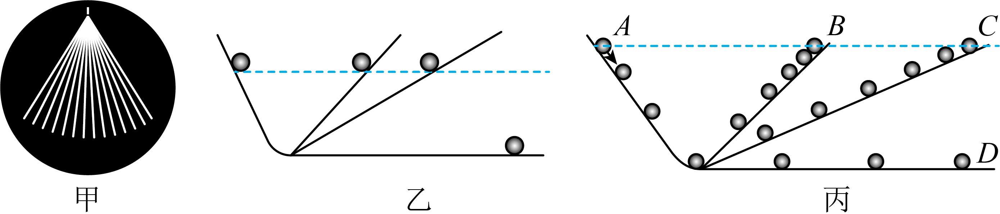

# Physics - 题目 926

**ID**: 4eb80f7cd1594e4a8a85f20d807a50c8
**年级**: Grade 8
**难度**: Medium-Hard
**题型**: Experiment

## 题目
牛顿在探究“阻力对物体运动的影响”实验后，揭开了物体运动的规律，从而得出了“牛顿第一定律”。​​​​​​​‌实验小组的同学利用如下图所示的装置进行探究。（1）为使小车每次到达水平面时的速度相等，每次都要让小车从斜面上的位置由静止开始自由下滑。（2）分别选用毛巾、棉布和木板进行实验，目的是通过改变从而改变小车在水平面运动时受到的摩擦阻力；实验过程中，应将毛巾、棉布平整地铺在段（选填“AB”、“BC”或“AC”）。（3）由于受到阻力作用，小车在水平面上做减速运动，运动到D点时速度为v_{1}，若此时所受外力突然消失，小车到达E点速度为v_{2}，则两者的大小关系是v_{1}v_{2}。（4）伽利略在400多年前的研究思想一直闪耀着理性的光辉。伽利略曾经观测到，钟摆来回摆动的高度是相同的，如图甲。他设想了这样一个实验：在左边一个固定的斜坡上滚下一个球，球又滚上右边不同坡度的斜坡，如果球没有受到摩擦阻力的作用，他认为这个球在右边任何坡度的斜坡上滚到的高度都与起始高度一样，好像这个球“记住”了起始高度。经过进一步思考，伽利略推断，如果右边的斜坡变成平坦，球将会一直匀速滚动下去，如图乙。请回答：①像科学家那样“进一步思考”：图丙是伽利略想象的每隔相同时间在右边不同坡度的斜坡上球的位置，他认为当斜坡倾角变小时，小球速度（选填“减小快”、“减小慢”或“不变”）。于是他大胆推测：当斜坡变成光滑而平坦时，小球将运动。这种研究方法是在客观实验基础上进行。②伽利略认为，球匀速滚动是球的“自然运动”状态，“自然运动”是球所具有的属性。在我们今天看来，球的这种属性称为。

## 解答

1. （1）每次都要让小车从斜面上的同一位置开始下滑，是为了使小车每次进入水平部分时速度大小相等，这是控制变量法的要求。
2. （2）要探究的是阻力对物体运动的影响，因此，应控制小车在到达水平面时的初速度相同，只改变小车在水平面运动时所受阻力的大小，即只改变水平面的粗糙程度，这就是分别选用毛巾、棉布和木板进行实验的目的。实验中，应让小车在不同的水平面上滑动，所以应将毛巾、棉布平整地铺在BC段。
3. （3）当小车运动到D点时速度为v_{1}，若此时小车所受外力突然消失，小车将做匀速直线运动，小车到达E点速度为v_{2}，即v_{2}与v_{1}大小相等。
4. （4）①由图中伽利略的实验过程可知，当斜坡倾角变小时，小球的速度减小得更慢。于是他大胆推测，当斜坡变成平坦时，球的速度不再变小，球将做匀速滚动；此时用到了科学推理法，在客观实验基础上进行科学推理。②一切物体都有保持原来运动状态不变的性质，叫惯性。伽利略所说的球的“自然运动”其实是球具有的属性，这就是惯性。

## 知识点

**中文**:
  - 阻力对物体运动影响的探究实验

**English**:
  - Experiment: Effect of Resistance on Motion

---
