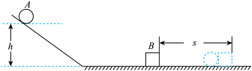

# Physics - 题目 278

**ID**: 4f3338138c8343bebad9a56f62a5a17b
**年级**: Grade 8
**难度**: Medium-Hard
**题型**: Experiment

## 题目
小希用如图所示的装置探究影响物体动能大小的因素。​​​​​​​‌（1）本实验中运用了物理研究方法中的转换法，用来表示小球动能的大小。（2）让同一个小球下落的高度不相同，是为了探究动能的大小与的关系。若换用不同质量的小球从同一高度下落，是为了探究动能的大小与的关系。这种研究方法是法。与此研究方法相同的实验请举出一例。（3）某路段的标志牌如图所示，请结合实验结论说明：对机动车限定最高行驶速度的原因是：；对不同车型限定不同的最高行驶速度的原因是：。（4）若要继续探究阻力对物体运动的影响，那么需要在实验器材中改变即可。

## 解答

1. （1）[1]动能大小与速度和质量有关，探究物体动能大小与哪些因素有关时，物体动能的大小无法直接判断，但可以通过小球对木块做功的多少来体现小球动能的多少，即通过木块被推动的距离来判断小球动能的大小，用到的是转换法。
2. （2）[2]让同一小球从斜面的不同高度由静止滚下，两小球的质量相同，滚下的高度越大，到达水平面的速度越大，将木块推得越远，推动木块做功，所以，目的是为了探究动能的大小与速度的关系。
3. [3]换用质量不同的小球，使它们从斜面的同一高度由静止滚下，两小球的质量相同，滚下的高度越大，到达水平面的速度越大，将木块推得越远，推动木块做功，目的是为了探究动能的大小与质量的关系。
4. [4][5]物理学中探究一个量与多个因素之间的关系时，每一次只改变其中的某一个因素，而控制其余几个因素不变，从而研究被改变的这个因素对事物的影响，分别加以研究，最后再综合解决，这种方法叫控制变量法，故实验中的研究方法是控制变量法。利用控制变量法的实验有探究影响摩擦力大小的因素的实验、探究二力平衡条件的实验等。
5. （3）[6]机动车质量一定时，速度越大，动能就越大，所以需要对机动车限定最高行驶速度。
6. [7]在相同的道路上，不同车型的机动车质量不同，速度相同时，质量大的动能大，制动距离大，质量小的动能小，制动距离小，当制动距离相同时，不同车型限速就不同。
7. （4）[8]若要继续探究阻力对物体运动的影响，则该让小车从斜面同一高度由静止滑下，使小车到达水平面的速度相同，小车运动到粗糙程度不同的表面上，所以，需要在实验器材中改变接触面的粗糙程度。

## 知识点

**中文**:
  - 探究影响物体动能大小因素的实验

**English**:
  - Experiment: Factors Affecting Kinetic Energy

---
