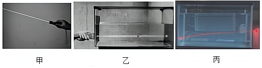

# Physics - 题目 2794

**ID**: 5268bd762c1f4631baa8f38862597b21
**年级**: Grade 8
**难度**: Medium-Hard
**题型**: Experiment

## 题目
在研究光的传播时，小明做了下面几个小实验：(1)图甲中，为了显示激光在空气中传播路径，可以在光的传播路径旁制造点。​​​​​​​‌图乙中，为了显示激光中在水中的传播路径，可以在水中加入少量的。(2)小明发现在玻璃缸中盛上清水，沿缸壁轻轻注入浓糖水，从侧壁水平照射激光，看到缸内光的路线如图丙所示，当搅拌缸中的水后，观察到光的路线呈直线，说明光沿直线传播的条件是。(3)图丁中，让一束平行光垂直于水平地面MN射下，A为小铁球（大小可不计）。若小球在竖直平面内沿图中半径为R的圆形虚线轨迹运动，关于小球的影子在地面MN上运动的轨迹，下列说法正确的是。

## 解答

1. (1)[1]图甲中，为了显示激光在空气中传播路径，可以在光的传播路径旁制造点烟雾、水雾等，利用光的漫反射来显示光路。
2. [2]图乙中，为了显示激光中在水中的传播路径，可以在水中加入少量的牛奶、咖啡等，可以得出光在均匀的液体中是沿直线传播的。
3. (2)[3]由于浓糖水的加入，使玻璃缸中的水密度不再均匀，光在其中不会沿直线传播，而发生折射；当搅拌缸中的水后，浓糖水与清水充分混合，变成了密度均匀的物质，光在同一种均匀介质中沿直线传播。
4. (3)[4]若小球在竖直平面内沿图中半径为R的圆形虚线轨迹运动，虽然小球沿图中圆形虚线轨迹运动，但是在每一点的影子，都是从这一点向地面做垂线，影子都在地面上，由于小球在竖直平面内沿圆形轨迹运动，根据圆的对称性，所以影子的轨迹在地面上是一条线段，轨迹的长度为2R，故D符合题意。

## 知识点

**中文**:
  - 光在同种均匀介质中沿直线传播

**English**:
  - Rectilinear Propagation in Homogeneous Media

---
