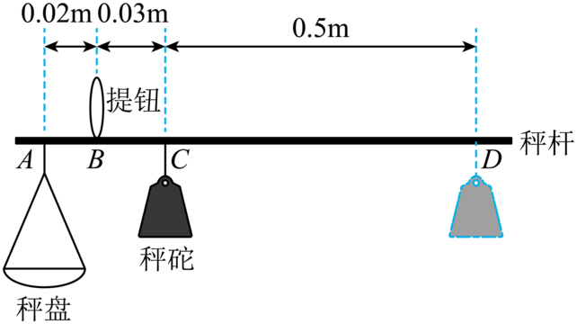

# Physics - 题目 220

**ID**: 533b4e6d05e0406aa468e5fc3d46c9a3
**年级**: Grade 8
**难度**: Medium-Hard
**题型**: Experiment

## 题目
在学习杠杆相关知识后，兴趣小组尝试了制作简易杆秤的实践活动。​​​​​​​‌（1）该兴趣小组制作的杆秤由秤杆、秤盘（放置待称量的物体）、提纽、秤砣组成，如图所示，提纽相当于杠杆五要素中的，结合“秤砣虽小压千斤”这句话，此时杆秤相当于（选填“省力”“等臂”或“费力”）杠杆。（2）A点为秤盘挂绳位置，B点为提纽位置，秤砣的质量为0.4kg，调节秤砣的位置到C点，此时秤杆恰好平衡，则C点为定盘星位置，对应的刻度线数值应为（选填“0”或“1”）。若秤砣最远可移至D点，则此杆秤最大可称量kg的物体。（3）图中杆秤要设置更大的量程，可在提纽B的（选填“左侧”或“右侧”）增加一个提纽，为确保对买卖双方公平，使用杆秤时，秤杆应在方向保持静止。

## 解答

1. （1）在放入待称物体后，移动秤砣让秤杆达到水平平衡过程中，秤杆在围绕提纽转动，根据杠杆的特点可知，提纽相当于杠杆中的支点。
2. 根据“秤砣虽小压千斤”，说明秤砣通过较长的力臂可以平衡较重的物体，根据杠杆分类条件，秤砣一边力臂长，则为省力杠杆。
3. （2） 秤砣在C点为定盘星位置，此时秤盘中未放物体，因此对应的刻度线数值应为0。
4. 由题可知， $m{{}_{砣}}=0.4{\rm{k}}{\rm{g}}$ ，  $L{{}_{1}}=0.5{\rm{m}}$  ， $L{{}_{{{2}}}}{\rm{=}}{{0}}{{.}}{{0}}{{2}}{\rm{m}}$ 。秤盘一侧和秤砣一侧杆秤受到的力分别为杠杆平衡条件中的阻力和动力，根据杠杆平衡条件 $F{{}_{1}}L{{}_{1}}=F{{}_{2}}L{{}_{2}}$ 可得 $G{{}_{砣}}L{{}_{1}}=G{{}_{物}}L{{}_{2}}\Rightarrow m{{}_{砣}}gL{{}_{1}}=m{{}_{物}}gL{{}_{2}}\Rightarrow m{{}_{砣}}L{{}_{1}}=m{{}_{物}}L{{}_{2}}$ ，可得 $m{{}_{物}}=\frac {m{{}_{砣}}L{{}_{1}}}{L{{}_{2}}}=\frac {0.4{\rm{k}}{\rm{g}}\times 0.5{\rm{m}}}{0.02{\rm{m}}}=10{\rm{k}}{\rm{g}}$ 。
5. （3）在秤砣质量不变的情况下，提纽位置越靠左，右边力臂越大，根据杠杆的平衡条件 $F{{}_{1}}L{{}_{1}}=F{{}_{2}}L{{}_{2}}$ ，到平衡时，左边秤盘里放入的物体越重，杆秤的量程就更大。
6. 杆秤的刻度是在水平平衡状态下标定的。只有在水平位置平衡时，刻度才能正确反映物体的重量。若倾斜，刻度值与实际重量的对应关系会被破坏，因此要在水平方向保持静止。

## 知识点

**中文**:
  - 跨学科实践

**English**:
  - Interdisciplinary Practice

---
