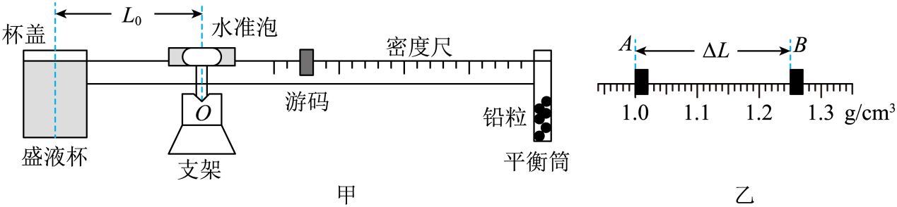

# Physics - 题目 2951

**ID**: 5fac63d5109449d58128d79b78fbfb5d
**年级**: Grade 8
**难度**: Medium-Hard
**题型**: Experiment

## 题目
如图甲是一种可直接从密度尺上读取待测液体密度的仪器，应用于油田、勘探和实验室对液体密度的测定。​​​​​​​‌（1）校正：将支架放在工作台上。在盛液杯中装满纯净水，擦干外壁后放在支架上，移动游码至1.0g/cm^{3}刻度处，观察到水准泡内的气泡偏右，即密度尺右边偏高，接下来的操作是（选填“添加”或“取出”）平衡筒内的铅粒直至气泡处于居中位置，密度尺水平平衡；（2）测量：完全倒去纯净水，装满待测钻井液后放在支架上。移动游码至B处时气泡居中，如图乙，读取该钻井液的密度为g/cm^{3}；（3）分析：如图甲，游码质量为56g，支点到盛液杯中轴线的距离L_{0}=12cm；如图乙，刻度线A、B的间距ΔL=7.5cm。推理计算盛液杯容积V=cm^{3}；（4）评估：实验时，装满待测钻井液后也要擦干外壁，若外壁有残留钻井液，会导致测量结果偏。

## 解答

1. （1）应该将支架放在水平的工作台上，观察到水准泡内的气泡偏右，即密度尺右边偏高，说明右侧拉力偏小，应往平衡筒内添加铅粒，直至气泡处于居中位置，密度尺水平平衡。
2. （2）由图可知，密度尺的分度值为0.01g/cm^{3}，示数为1.25g/cm^{3}，因此该钻井液的密度为1.25g/cm^{3}。
3. （3）根据杠杆平衡的原理可知，测量时满足G_{液}L_{0}=G_{游}ΔL，即m_{液}gL_{0}=m_{游}gΔL，m_{液}L_{0}=m_{游}ΔL，则 $m{{}_{液}}=\frac {ΔL}{L{{}_{0}}}m{{}_{游}}=\frac {7.5{\rm{c}}{\rm{m}}}{12{\rm{c}}{\rm{m}}}\times 56{\rm{g}}=35{\rm{g}}$ ，因此液杯容积 $V=V{{}_{液}}=\frac {m{{}_{液}}}{ρ{{}_{液}}}=\frac {35{\rm{g}}}{1.25{{\rm{g}}}/{{\rm{c}}{\rm{m}}{^{3}}}}=28{\rm{c}}{\rm{m}}{^{3}}$ 。
4. （4）实验时，装满待测钻井液后也要擦干外壁，若外壁有残留钻井液，则会使左侧液体重力偏大，游码需要往右移动才能使密度尺平衡，因此测出的结果会偏大。

## 知识点

**中文**:
  - 特殊方法测密度

**English**:
  - Special Methods for Measuring Density

---
