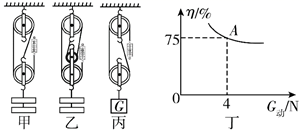

# Physics - 题目 2967

**ID**: 69b09a14f94a4814908dd6749b897c43
**年级**: Grade 8
**难度**: Medium-Hard
**题型**: Experiment

## 题目
某实验小组在测滑轮组机械效率的实验中得到的数据如表所示，实验装置如图所示。​​​​​​​‌实验次数123钩码重G/N446钩码上升的高度h/m0.10.10.1绳端拉力F/N1.81.62.4绳端上移的距离s/m0.30.4机械效率η74.1%62.5%（1）通过表中数据可分析出第2次实验是用（填“甲”或“乙”）图所示装置做的实验；（2）通过第1次实验和第2次实验的数据分析可得出结论：使用不同的滑轮组提升相同的重物时，动滑轮的个数越多（动滑轮的质量越大），滑轮组的机械效率（填“越高”“不变”或“越低”）；（3）小组同学再用第1次实验中使用的装置做第3次实验，表中第3次实验中空缺的数据应为绳端移动距离s=；机械效率η=；（结果保留一位小数）（4）比较第1次实验和第3次实验可得出结论：。（5）只要滑轮组结构一定，知道绕动滑轮的有n段细绳，测滑轮组机械效率的实验器材就可以不需要（填一种测量工具名称），且机械效率的表达式通式为η=（用本题中有关字母表示）；（6）如采用图丙装置改变动滑轮重G，提升同一物体进行多次实验，获得数据并绘制出如图丁的图象，分析图象中的A点可知，被提升物体所受的重力为N（忽略绳重和摩擦）。

## 解答

1. （1）第二次实验中，绳子的有效段数
2. $n=\frac {s}{h}{\rm{=}}\frac {{\rm{0}}{\rm{.}}{\rm{4}}{\rm{m}}}{{\rm{0}}{\rm{.}}{\rm{1}}{\rm{m}}}{\rm{=}}{\rm{4}}$
3. 因此选择乙装置进行实验。
4. （2）根据s=nh可知，第一次实验绳子的有效段数为3，故通过第1次实验和第2次实验的数据分析可得出结论：使用不同的滑轮组提升相同的重物时，动滑轮的个数越多（动滑轮的质量越大），滑轮组的机械效率越低。
5. （3）用第1次实验中使用的装置做第3次实验，绳子的有效段数为3，绳端移动距离
6. s=nh=3×0.1m=0.3m
7. 机械效率
8. $η=\frac {W{{}_{有}}}{W{{}_{总}}}=\frac {Gh}{Fs}=\frac {6{\rm{N}}\times 0.1{\rm{m}}}{2.4{\rm{N}}\times 0.3{\rm{m}}}\approx 83.3\%$
9. （4）因第1、3次实验用同一滑轮组做的实验，故比较第1次实验和第3次实验可得出结论：使用同一滑轮组，提升物体的重力越大，机械效率越高。
10. （5）由
11. $η=\frac {W{{}_{有}}}{W{{}_{总}}}=\frac {Gh}{Fs}=\frac {Gh}{Fnh}=\frac {G}{nF}\times 100\%$
12. 可知，已知提升物体绳子的股数时，只需要测量G和F，因此测量工具只需要弹簧测力计，不需要刻度尺；故机械效率的表达式为
13. $η=\frac {G}{nF}\times 100\%$
14. （6）忽略绳重和摩擦，则克服动滑轮的重做的功为额外功的唯一来源，由
15. $η=\frac {W{{}_{有}}}{W{{}_{总}}}=\frac {Gh}{Gh+G{{}_{动}}h}=\frac {G}{G+G{{}_{动}}}\times 100\%$
16. 由图丙装置知，当动滑轮重为1N时，机械效率为75%，则
17. $75\%=\frac {G}{G+4{\rm{N}}}\times 100\%$
18. 故被提升物体所受的重力G=12N。

## 知识点

**中文**:
  - 滑轮（组）的机械效率的测量实验

**English**:
  - Experiment: Measuring Mechanical Efficiency of Pulleys

---
