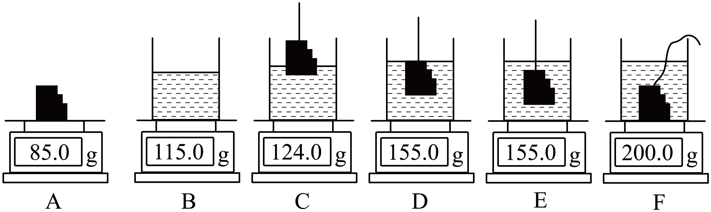

# Physics - 题目 2888

**ID**: 6da934f756da4e5a91319c4142279d8a
**年级**: Grade 8
**难度**: Medium-Hard
**题型**: Experiment

## 题目
实验课上，老师为小明同学提供电子秤、烧杯和水，测量塑料块的密度，实验过程如下：（1）将电子秤放在水平桌面上并归零，测出塑料块的质量，如图A所示；（2）将空烧杯放在电子秤上，再次归零后，将适量水倒入烧杯中，测出的质量如图B所示；（3）用细线系住塑料块缓缓浸入水中，如图C所示，此时，烧杯底部所受液体压力变化量为N；（4）继续实验，记录电子秤的示数分别如图C、D、E所示，对比B、C、D、E四次实验可以验证：浸在液体中的物体所受的浮力大小与有关，与无关；（5）松开细线，塑料块沉入水底，如图F所示，则：①塑料块所受浮力为N；②塑料块的密度为${\rm{k}}{\rm{g}}/{\rm{m}}{^{3}}$ 。​​​​​​​‌（6）老师为小张同学提供的测量工具为弹簧测力计，小张同学用弹簧测力计测出塑料块的重力记为G。然后将塑料块浸没在水中，此时弹簧测力计的示数记为F，则塑料块密度 $ρ{{}_{塑}}=$（填表达式，水的密度用 $ρ{{}_{水}}$ 表示）；（7）对两组实验进行评估，你觉得谁的测量方法更优，说明理由：。

## 解答

1. （3）由图可知，图C中排开液体的质量为 $m{{}_{排1}}=124.0{\rm{g}}-115.0{\rm{g}}=9.0{\rm{g}}$
2. 根据力的相互作用，塑料块对水有向下的压力，压力大小等于浮力，电子秤示数变化量反映了这个压力的大小，烧杯底部所受液体压力变化量为 $ΔF{{}_{1}}=F{{}_{浮1}}=G{{}_{排1}}=m{{}_{排1}}g=0.009{\rm{k}}{\rm{g}}\times 10{\rm{N}}{\rm{/}}{\rm{k}}{\rm{g}}{\rm{=}}{{0}}{{.}}{{0}}{{9}}{\rm{N}}$
3. （4）观察图C、D、E可知，塑料块浸入水中的体积逐渐增大，电子秤的示数也逐渐增大，当浸没后，物体浸没的深度增加，电子秤的示数不变。 根据力的相互作用，塑料块对水有向下的压力，压力大小等于浮力，电子秤示数变化量反映了这个压力的大小，所以电子秤示数的变化量等于塑料块受到的浮力，当塑料块全部浸没后排开水的体积不变，压力不变，则所受浮力不变。说明浸在液体中的物体所受的浮力大小与物体排开液体的体积有关，与浸没的深度无关。
4. （5）根据B、E图可知，塑料块浸没在水中时排开水的质量为 $m{{}_{排}}=155.0{\rm{g}}-115.0{\rm{g}}=40.0{\rm{g}}=0.04{\rm{k}}{\rm{g}}$
5. 塑料块浸没在水中时所受浮力为 $F{{}_{浮}}=G{{}_{排}}=m{{}_{排}}g=0.04{\rm{k}}{\rm{g}}\times 10{\rm{N}}{\rm{/}}{\rm{k}}{\rm{g}}=0.4{\rm{N}}$
6. 由图F可知，松开细线，塑料块沉入水底，塑料块排开水的体积不变，浮力不变，仍为0.4N。
7. 由于浸没，塑料块体积为 $V=V{{}_{排}}=\frac {m{{}_{排}}}{ρ{{}_{水}}}=\frac {{{4}}{{0}}{{.}}{{0}}{\rm{g}}}{{{1}}{{.}}{{0}}{\rm{g}}{\rm{/}}{\rm{c}}{\rm{m}}{^{{{3}}}}}{\rm{=}}{{4}}{{0}}{\rm{c}}{\rm{m}}{^{{{3}}}}$
8. 塑料块密度为 $ρ=\frac {m}{V}=\frac {{{8}}{{5}}{{.}}{{0}}{\rm{g}}}{{{4}}{{0}}{\rm{c}}{\rm{m}}{^{{{3}}}}}{\rm{=}}{{2}}{{.}}{{1}}{{2}}{{5}}{\rm{g}}{\rm{/}}{\rm{c}}{\rm{m}}{^{{{3}}}}{\rm{=}}{{2}}{{.}}{{1}}{{2}}{{5}}\times {{1}}{{0}}{^{{{3}}}}{\rm{k}}{\rm{g}}{\rm{/}}{\rm{m}}{^{{{3}}}}$
9. （6）同学用弹簧测力计测出塑料块的重力记为G。然后将塑料块浸没在水中，此时弹簧测力计的示数记为F，浸没时塑料块受到的浮力为 $F{{}_{浮2}}=G-F$
10. 浸没时物体的体积等于排开液体的体积，即 $V{{}_{物}}=V{{}_{排}}$ ，可以得到 $\frac {G{{}_{塑}}}{F{{}_{浮2}}}=\frac {ρ{{}_{塑}}gV{{}_{物}}}{ρ{{}_{水}}gV{{}_{排}}}=\frac {ρ{{}_{塑}}}{ρ{{}_{水}}}$
11. 则塑料块密度 $ρ{{}_{塑}}=\frac {G{{}_{塑}}}{F{{}_{浮2}}}ρ{{}_{水}}=\frac {G}{G-F}ρ{{}_{水}}$
12. （7）对两组实验进行评估，小明同学将电子秤放在水平桌面上并归零，测出塑料块的质量，将空烧杯放在电子秤上，再次归零后，将适量水倒入烧杯中，测出的质量，操作过程合理，小张同学用弹簧测力计测出塑料块的重力记为G。然后将塑料块浸没在水中，此时弹簧测力计的示数记为F，操作过程合理，两人操作过程都很合理，可以避免物体上沾水影响实验结果，但是弹簧测力计的精确程度没有电子秤的精确度高，并且读数时会因为视线没有正对刻度线而带来误差，所以小明同学测量方法更优。

## 知识点

**中文**:
  - 特殊方法测密度

**English**:
  - Special Methods for Measuring Density

---
