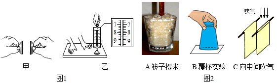

# Physics - 题目 1353

**ID**: 82acf436e36f484fb2976350e5b93f23
**年级**: Grade 8
**难度**: Medium-Hard
**题型**: Experiment

## 题目
(1)小明用两个挂东西的小吸盘，按如图1甲对接，挤出吸盘内部的空气，然后拉开吸盘，拉开吸盘需要用较大的力，这说明了存在。​​​​​​​‌小明由此联想到：把吸盘吸在固定的光滑平面上（如图1乙所示）可以粗略测大气压的值，他的实验步骤如下，①将沾水的塑料挂钩吸盘按压在光滑水平的玻璃板上，用力挤压吸盘；②量出吸盘与玻璃板接触面的直径，计算出吸盘与玻璃板的接触面积S＝1cm^{2}；③用弹簧测力计钩住挂钩缓慢向上拉，直到塑料吸盘刚好脱离玻璃板面，记下弹簧测力计的示数；④根据公式计算出大气压的大小。(2)使用中小明将沾水的吸盘放在光滑的玻璃板上，用力挤压吸盘的目的是；(3)如图乙所示，为塑料吸盘，刚好脱离玻璃板面，弹簧测力计的示数F＝N，通过计算，可得，此时大气压的值为Pa；(4)通过实验测大气压的值与1个标准大气压相差较大，请你帮小明找出两种可能的原因是和；(5)读图2所示都是物理课本中的实验，其中一个用来说明大气压存在的是。

## 解答

1. (1)[1]通过比较吸盘内和吸盘外的压强，当外界压强大于内部压强时，大气压产生较大的压力作用在吸盘上，证明大气压强的存在。
2. (2)[2]蘸水和用力挤压吸盘都是为了尽量将吸盘内的空气排干净，这样里面没有气压，外面的大气压才能将其紧紧压在玻璃板上。
3. (3)[3][4]由压强的计算公式 $p=\frac {F}{S}$ 可知：要粗略计算出大气压的大小，先挤出了吸盘与光滑平面内的空气，测出了吸盘刚好脱离光滑平面时的拉力F的大小为8.4N，吸盘的面积为1cm^{2}＝10^{-4}m^{2}，由压强公式可知
4. $p=\frac {F}{S}=\frac {8.4{\rm{N}}}{{\rm{1}}\times 10{^{-4}}{\rm{m}}{^{2}}}={\rm{8}}{\rm{.}}{\rm{4}}\times 10{^{4}}{\rm{P}}{\rm{a}}$
5. (4)[5][6]造成实验结果相差很大的原因有很多，吸盘与玻璃板是否接触紧密是一个重要参考因素；所以可能是吸盘漏气，或吸盘与接触面之间有杂质，或吸盘内空气没有排干净等。
6. (5)[7]A图中筷子在摩擦力作用下提起米杯；B图杯中的水在大气压力作用下被托起，证明了大气压的存在；C图向张纸中间吹气，由于流体流速大的地方压强小，两张纸向蹭靠拢；故选B。

## 知识点

**中文**:
  - 大气压强的存在实验
  - 大气压强的测量及标准大气压
  - 流体压强与流速关系的探究实验

**English**:
  - Experiment: Existence of Atmospheric Pressure
  - Measurement of Atmospheric Pressure & Standard ATM
  - Experiment: Fluid Pressure vs Flow Speed

---
