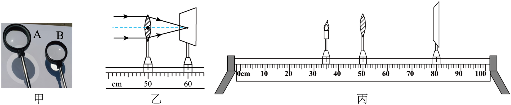

# Physics - 题目 2567

**ID**: 894dc740a1c941838e7b91fe53d3cb8f
**年级**: Grade 8
**难度**: Medium-Hard
**题型**: Experiment

## 题目
某小组做探究“凸透镜成像规律”的实验。​​​​​​​‌（1）如图甲所示，将A、B两块透镜分别正对太阳光时，在离透镜较近的光屏上，B透镜出现了缩小的光斑。当移动到一定距离，出现最小最亮的光斑。由此判断B透镜对光具有作用；由图乙知，该凸透镜的焦距 $f=10.0{\rm{c}}{\rm{m}}$ ；（2）实验前，将烛焰和凸透镜的中心及光屏中心调整在同一高度上，目的是；（3）当各元件位置如图丙所示时，光屏上恰好成清晰的像，这时烛焰在光屏上成倒立、（“放大”“等大”“缩小”）的实像；（4）保持凸透镜位置不动，小红将蜡烛移至20.0cm刻度线处，要想得到清晰的像，光屏应移至cm刻度线处，此时成倒立、（“放大”“等大”“缩小”）的实像；（5）实验过程中，蜡烛由于燃烧而逐渐变短，则烛焰的像在光屏上的位置会向（选填“上”或“下”）移动，为了能让烛焰的像回到光屏的中央，最科学合理的调节方法是；

## 解答

1. （1）由图甲可知，太阳光经过B透镜，在光屏上出现了缩小的光斑，说明B透镜对光线有会聚作用，是凸透镜。
2. （2）实验中为了使像成在光屏的中央，实验前，需要将烛焰和凸透镜的中心及光屏中心调整在同一高度上。
3. （3）由图丙可知，此时物距小于像距，光屏上恰好成清晰的像，根据凸透镜成像规律，此时成正立放大的实像。
4. （4）图丙中，物距为 $u=50.0{\rm{c}}{\rm{m}}-35.0{\rm{c}}{\rm{m}}=15.0{\rm{c}}{\rm{m}}$ ，像距为 $v=80.0{\rm{c}}{\rm{m}}-50.0{\rm{c}}{\rm{m}}=30.0{\rm{c}}{\rm{m}}$ ，此时成倒立放大的实像。保持凸透镜位置不动，小红将蜡烛移至20.0cm刻度线处，则物距为 $u^{′}=50.0{\rm{c}}{\rm{m}}-20.0{\rm{c}}{\rm{m}}=30.0{\rm{c}}{\rm{m}}$ ，根据光路可逆，要想得到清晰的像，像距应为15.0cm，因此光屏的位置应为 $50.0{\rm{c}}{\rm{m}}+15.0{\rm{c}}{\rm{m}}=65.0{\rm{c}}{\rm{m}}$ ，此时物距大于像距，成倒立缩小的实像。
5. （5）蜡烛由于燃烧而逐渐变短，焰心与凸透镜的光心连线会偏上，烛焰的像在光屏上的位置会向上移动，为了使像成在光屏的中央，可将蜡烛向上调节，或将凸透镜向下调节，或将光屏向上调节。故C符合题意，AB不符合题意。
6. （6）若有萤火虫挡住凸透镜的上半部分，会挡住部分光线，所成的像是完整的，但由于通过的光线减少，像的亮度会变暗。故ABC不符合题意，D符合题意。

## 知识点

**中文**:
  - 凸透镜成像规律的探究实验

**English**:
  - Experiment: Imaging Rules of Convex Lenses

---
