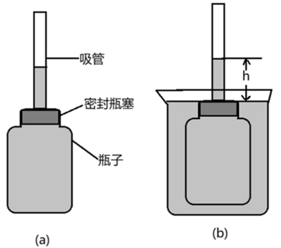

# Physics - 题目 2553

**ID**: 8a6a2e7bf5424f1ca4deee6073bf5c49
**年级**: Grade 8
**难度**: Medium-Hard
**题型**: Experiment

## 题目
如图（a）所示为某课外小组自制的温度计，瓶子作为液泡装满某种液体，在密封的瓶塞上插上足够长的细管。​​​​​​​‌为了探究薄壁细管内的液柱高度h与哪些因素有关，他们首先选用横截面积为S_{1}的细管进行实验，把液泡浸没在不同温度的水中，如图（b）所示，并将数据记录在表一中。然后换用横截面积为S_{2}的细管重复实验，将数据记录在表二中。（已知S_{1}>S_{2}）表一   横截面积S_{1}序号温度液柱高度h（cm）温度变化量Δt（℃）液柱高度的变化量Δh（cm）105102210732092044401356017408610025表二   横截面积S_{2}序号温度液柱高度h（cm）温度变化量Δt（℃）液柱高度的变化量Δh（cm）70651.5857.59109206103015116024309129033（1）分析比较实验序号的数据及相关条件，可得出的初步结论是：同一液泡，t相同时，S越小，h越大。（2）分析比较表一（或表二）中液柱高度h和温度t的数据及相关条件，可得出的 初步结论是：。（3）接着该小组又研究了表一（或表二）中液柱高度变化量Δh和温度变化量Δt的关系，可归纳得到结论：。

## 解答

1. [1]根据控制变量法，要比较细管横截面积S和液柱高度h的关系，就要控制其他的变量相同，即控制液泡和温度t相同，改变细管横截面积S，观察液柱高度h的变化，所以分析比较实验序号1和7（或2和9、或5和11）的数据及相关条件，可得出的初步结论是：同一液泡，t相同时，S越小，h越大。
2. [2]根据控制变量法，分析比较表一（或表二）中液柱高度h和温度t的数据及相关条件，可得出的 初步结论是：同一液泡，细管横截面积S相同时，温度t越大，液柱高度h越大。
3. [3]根据控制变量法，研究了表一（或表二）中液柱高度变化量Δh和温度变化量Δt的关系，可归纳得到结论：同一液泡，细管横截面积S相同时，温度变化量Δt越大，液柱高度变化量Δh越大。

## 知识点

**中文**:
  - 物理常识及物理学史

**English**:
  - General Physics Knowledge and History

---
