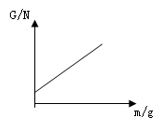
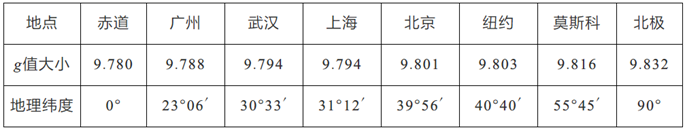

# Physics - 题目 1776

**ID**: 8b0938a0d61e463bb337519c481e86b3
**年级**: Grade 8
**难度**: Medium-Hard
**题型**: Experiment

## 题目
班级里在探究物体所受重力的大小与质量的关系时，第一组记录的数据如表所示：实验序号物体质量/kg物体重力/N重力与质量的比值/（N/kg）10.111020.221030.3310(1)在实验过程中，需要的测量工具有和；(2)根据表格中的实验数据，并且由此得到的结论是：；(3)某同学根据自己测量的数据，绘制出重力与质量的关系图像如图(1)所示，你认为该同学在实验中存在的问题是什么？答：。​​​​​​​‌(4)第二组：探究物体重力的大小跟物体形状的关系，研究小组用橡皮泥为实验对象，用小刀将橡皮泥雕刻成各种形状进行实验，实验数据如表(2)所示。分析实验数据，第二组得出实验结论：物体重力的大小与物体的形状有关。他们的结论（选填“正确”或“错误”），影响实验结果的原因是：；被测物体形状重力橡皮泥正方形4.8N圆形4.2N三角形3.6N(5)第三小组经过精确测量，并在互联网上与不同地区的同学进行了交流合作，发现在某些不同的地理位置，g值存在着微小差异。下表(3)列出了一些城市和地区的g值大小：由表分析g值相同的城市是：。造成g值不同的原因可能是：。我国与许多国家之间的贸易往来频繁，在这些往来的货物运输中，发货单上所标示的“货物重量”，实质上应该是货物的。

## 解答

1. (1)[1][2]本实验需要测量质量和重力，所以需要的测量工具有天平和弹簧测力计。
2. (2)[3]由重力和质量的比值相同可知，物体所受的重力与质量成正比。
3. (3)[4]由图像知道，当质量为0时，重力不为零，所以使用前，弹簧测力计未校正零点。
4. (4)[5][6]继续探究重力与形状的关系时，应该控制质量相等，而用小刀将橡皮泥雕刻成各种形状时，质量发生了变化，所以结论不正确。
5. (5)[7][8][9]由表格可知，武汉和上海的g值相同，不同维度的地方的g值不同，且维度越高，g值越大；当我国与许多国家之间发生贸易时，维度发生了变化，所以重力发生了变化，但质量不变，所以货单上所标示的“货物重量”，实质上应该是质量。

## 知识点

**中文**:
  - 探究物重与物体质量的关系实验

**English**:
  - Experiment: Relationship between Weight and Mass

---
