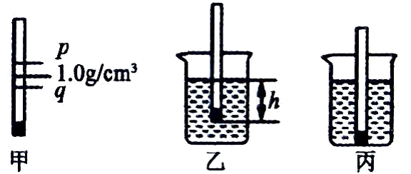

# Physics - 题目 2706

**ID**: 8cc27a2725c447d5b0cdd25c8092846c
**年级**: Grade 8
**难度**: Medium-Hard
**题型**: Experiment

## 题目
小明按照教材中“综合实践活动”的要求制作了简易密度计.​​​​​​​‌取一根粗细均匀的饮料吸管，在其下端塞入适量金属丝并用石蜡封口.（1）为了给密度计标上刻度，他进行了如下操作:a.将其放入水中，竖立漂浮后，在密度计上与水面相平处标上1.0 g/cm^{3};b.将其放入密度0. 9 g/cm^{3}植物油中，用同样的方法在密度计上标上0.9 g/cm^{3};c.接着他以两刻度线间的长度表示0.1 g/cm^{3}，将整个饮料吸管均匀标上刻度;①如图甲所示，小明制作的密度计，你认为刻度0.9 g/cm^{3}应该在点（选填“p”或“q”）.②如图乙所示，若被测液体的密度为ρ_{液}、密度计浸入被测液体的深度为h、自制密度计的质量为m，横截面积为S，用给定的字母推导出ρ_{液}与h的关系式为.通过关系式可知:小明这样均匀标注刻度是的（选填“正确”、“错误”）.（2）小红为了让测量结果更准确，想使简易密度计上两条刻度线之间的距离大一些，请为小红设计一种改进方法:.（3）小虎将制作好的密度计放入某液体中，出现如图丙所示的现象，为顺利完成实验任务，你的解决办法是.（合理即可）

## 解答

1. 第一空．由分析知，根据阿基米德原理 $V{{}_{排}}=\frac {F{{}_{浮}}}{ρ{{}_{液}}g}$ 浮力不变，液体密度越大，排开液体的体积越小，密度计浸入液体的深度越浅，因此刻度0.9 g/cm^{3}应该在图丙中的p位置；
2. 第二空．因为漂浮，所以：
3. F_{浮}=G=mg
4. 由阿基米德原理 $V{{}_{排}}=\frac {F{{}_{浮}}}{ρ{{}_{液}}g}$ 可得
5. $Sh=\frac {mg}{ρ{{}_{液}}g}=\frac {m}{ρ{{}_{液}}}$
6. 即
7. $h=\frac {m}{Sρ{{}_{液}}}$ ；
8. 第三空．因为密度计质量一定，横截面积一定，由推导式 $h=\frac {m}{Sρ{{}_{液}}}$ 可知h与ρ_{液}成反比，因此均匀标注刻度是错误的；
9. 第四空．质量一定时，换用更细的吸管，此时横截面积变小，长度变长，由推导式 $h=\frac {m}{Sρ{{}_{液}}}$ 可知，此时两条刻度线之间的距离会大一些，测量更精确；
10. 第五空．如图所示，密度计沉底，此时密度计受到的浮力小于重力，为使密度计漂浮顺利测出密度，由阿基米德原理 $F{{}_{浮}}=ρ{{}_{液}}V{{}_{排}}g$ 可知应增大排开液体的体积，换用更深更细长的容器盛装该液体进行测量．

## 知识点

**中文**:
  - 密度计的原理及应用
  - 阿基米德原理的应用

**English**:
  - Principle and Application of Hydrometer
  - Applications of Archimedes' Principle

---
