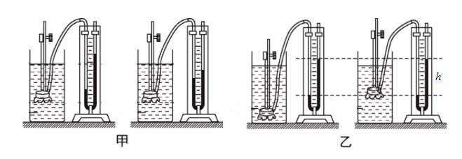
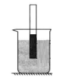

# Physics - 题目 1245

**ID**: 8f4b9fb42c314f49ab7cb98297789ac3
**年级**: Grade 8
**难度**: Medium-Hard
**题型**: Experiment

## 题目
在学习了液体压强的知识后，小明用同一U形管压强计分别比较两种不同液体密度的大小。​​​​​​​‌（1）压强计的气密性良好，用手指按压橡皮膜时，通过U形管中水面的来反映液体压强大小。（2）将该压强计的金属盒先后放入密度为p_{1}、p_{2}的两种液体中，看到的现象如图甲所示，他控制了相同，从这个实验可以比较出两种液体密度的大小关系是ρ_{1}ρ_{2}。（选填“大于”、“小于”或“等于”）。（3）将该压强计的金属盒先后放入密度为ρ_{3}、ρ_{4}的两种液体中，看到的现象如图乙所示，他控制了相同，从这个实验可以比较出两种液体密度的大小关系是ρ_{3}ρ_{4}。（选填“大于”、“小于”或“等于”）（4）两位同学用一根粗细均匀两端开口的薄玻璃管、薄橡皮膜、刻度尺、烧杯和水（已知ρ_{水}=1.0×10^{3}kg/m^{3}），来测量某种液体的密度。实验过程如下：①将玻璃管的一端用细线把橡皮膜扎好；②将玻璃管扎有薄膜的一端逐渐插入装有水的烧杯中；③往玻璃管内缓慢加入待测液体直到为止（如图所示）测出薄膜到水面和液面的距离分别为h_{1}和h_{2}；④计算待测液体的密度ρ_{液}=。

## 解答

1. （1）[1]压强计是通过U形管中两液面的高度差来反映被测压强大小的。
2. （2）[2]该压强计的金属盒先后放入密度为ρ_{1}、ρ_{2}的两种液体中，由图甲可知，金属盒的深度相同，左边压强计U形管内液面高度差较大，说明液体的压强较大。
3. [3]由于深度相同，液体的密度越大，产生的压强越大，所以液体密度大小关系
4. ρ_{1}＞ρ_{2}
5. （3）[4]将该压强计的金属盒先后放入密度为ρ_{3}、ρ_{4}的两种液体中，由图乙可知，压强计U形管内液面高度差相同，左边金属盒浸入液体较深。
6. [5]液体压强相同时，深度越深，液体的密度越小，所以液体密度大小关系
7. ρ_{3}＜ρ_{4}
8. （4）③[6]往玻璃管内缓慢加入待测液体直到薄膜变平为止（如图所示）测出薄膜到水面和液面的距离分别为h_{1}和h_{2}。
9. [7]由薄膜变平可知，玻璃管内外受到的液体压强相等，则
10. ρ_{液}gh_{2}=ρ_{水}gh_{1}
11. ρ_{液}= $\frac {h{{}_{1}}}{h{{}_{2}}}ρ{{}_{水}}$

## 知识点

**中文**:
  - 密度计的原理及应用
  - 探究液体压强的特点实验

**English**:
  - Principle and Application of Hydrometer
  - Experiment: Characteristics of Liquid Pressure

---
