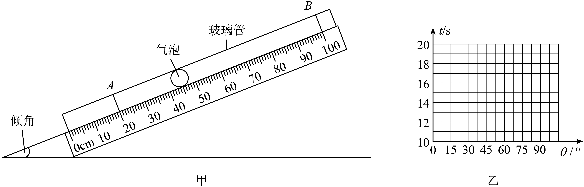

# Physics - 题目 2727

**ID**: 8f97f42104264cbeb64ff33578b58a7a
**年级**: Grade 8
**难度**: Medium-Hard
**题型**: Experiment

## 题目
在研究“气泡运动规律”实验时，小明在细玻璃管中注入水，管中留一个小气泡，将玻璃管翻转后，观察气泡的运动情况，如图甲所示。​​​​​​​‌气泡的运动快慢到底与哪些因素有关呢？他做出了如下猜想：猜想一：跟气泡的大小有关；猜想二：跟玻璃管与水平面的倾角有关。为了便于研究，他在玻璃管上做上记号A、B，测出气泡经过AB段的时间。实验数据记录如表。表一表二表三气泡长度1cm倾角t/s气泡长度2cm倾角t/s气泡长度4cm倾角t/s实验序号115°15.8实验序号615°22.5实验序号1115°18.2230°14.1730°14.91230°16.1345°13.7845°12.21345°12.5460°17.7960°13.81460°13.5590°29.81090°19.91590°19.1（1）实验中，除刻度尺、秒表外，还需要的测量器材为，气泡通过AB段的路程为cm。（2）实验中，为便于测量时间，应设法使管内气泡运动得（选填“快”或“慢”）一些。计时的起点位置（选填“能”或“不能”）标记在玻璃管的最下端。（3）请在图乙中作出表三中“气泡运动的时间随倾角变化”的图像。（4）小明同学分析表中的数据，发现玻璃管的倾角为45°且气泡长度为2cm时，气泡运动得最快，你认为他的结论（选填“可”或“不可”）靠。（5）小华换用粗玻璃管后改变气泡大小又做了两组实验，数据记录如表四，分析数据可知：大、小气泡在玻璃管中都做匀速直线运动，试推断小气泡在运动40cm时所需的时间为s。表四：从O点开始运动的距离s/cm020406080100小气泡运动的时间t/s03.6一10.814.418.0大气泡运动的时间t/s03.46.810.213.617.0

## 解答

1. （1）实验中，除刻度尺、秒表外，还需要的测量器材为量角器，刻度尺的分度值为1cm，估读到分度值的下一位，气泡通过AB段的路程为 $100.0{\rm{c}}{\rm{m}}{{-}}{{2}}{{0}}{{.}}{{0}}{\rm{c}}{\rm{m}}{\rm{=}}{{8}}{{0}}{{.}}{{0}}{\rm{c}}{\rm{m}}$ 。
2. （2）物体运动的越慢，越易于测量时间，故应使气泡在管内运动得较慢。因为气泡刚开始运动是变速的，所以计时的起点位置不能在最下方。
3. （3）将表中的数据在坐标系中逐一描出，连接各点即为气泡运动的倾角～时间图像，如下图所示：
4. 
5. （4）多次实验的目的是寻找普遍规律，表中数据玻璃管的倾角为45°且气泡长度为2cm时，气泡运动得最快，但实验次数太少，他的结论不可靠。
6. （5）大、小气泡在玻璃管中都做匀速直线运动，则小气泡在运动40cm时所需的时间 $t=\frac {s}{v}=\frac {40{\rm{c}}{\rm{m}}}{\frac {100{\rm{c}}{\rm{m}}}{18.0{\rm{s}}}}=7.2{\rm{s}}$ 。

## 知识点

**中文**:
  - 速度变化的探究实验

**English**:
  - Experiment: Investigating Speed Change

---
