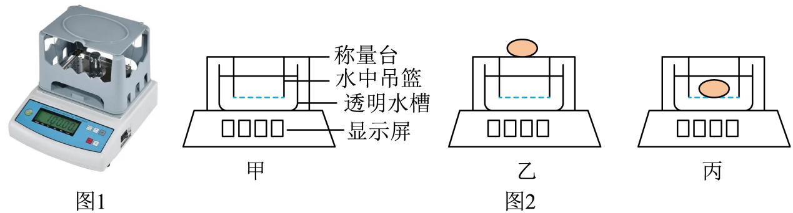

# Physics - 题目 475

**ID**: 9352576ef92f46c98faabe9ae8bc8b64
**年级**: Grade 8
**难度**: Medium-Hard
**题型**: Experiment

## 题目
如图1是可直接读取固体密度的工业密度仪，其基本结构如图2甲。​​​​​​​‌研究人员用它测量一个产品的密度。（1）技术参数最大承重300g最小质量测量0.01g量程$0.001-99.999{\rm{g}}{\rm{/}}{\rm{c}}{\rm{m}}{^{3}}$分度值$0.001{\rm{g}}{\rm{/}}{\rm{c}}{\rm{m}}{^{3}}$测量原理阿基米德原理测试时间5-20s（2）使用步骤与数据记录（如图2）①将仪器放在工作台，按下“置零去皮”键；②将待测产品放在称量台上，待数值稳定后读取空气中质量为18.000g，如图乙；③用镊子将待测产品放在水中吊篮上，使其在水中浸没，待数值稳定后读取水中质量12.000g，如图丙：测出产品体积为${\rm{c}}{\rm{m}}{^{3}}$ 。④读取密度值${\rm{g}}{\rm{/}}{\rm{c}}{\rm{m}}{^{3}}$ 。（3）评估①若第③步水槽中的水没有没过待测产品，测出的密度偏。②若第③步操作时待测产品外壁有气泡，测出的密度偏。

## 解答

1. 为了测量质量准确，应将仪器放在水平工作台上，按下“置零去皮”键。
2. 根据题意可知，待测产品的质量为18.000g；待测产品放在水中吊篮上，使其在水中浸没，待数值稳定后读取水中质量12.000g，待测产品受到的浮力为F_{浮}=m_{1}g-m_{2}g=18.000×10^{-3}kg×10N/kg-12.000×10^{-3}kg×10N/kg=0.06N，待测产品的体积为 $V=V{{}_{排水}}=\frac {F{{}_{浮}}}{ρ{{}_{水}}g}=\frac {{{0}}{{.}}{{0}}{{6}}{\rm{N}}}{1.0\times 10{^{3}}{\rm{k}}{\rm{g}}{\rm{/}}{\rm{m}}{^{{{3}}}}\times 10{\rm{N}}/{\rm{k}}{\rm{g}}}=6\times 10{^{-6}}{\rm{m}}{^{{{3}}}}=6{\rm{c}}{\rm{m}}{^{{{3}}}}$ ，待测产品的体积为 $ρ=\frac {m}{V}=\frac {{{1}}{{8}}{{.}}{{0}}{{0}}{{0}}{\rm{g}}}{{{6}}{\rm{c}}{\rm{m}}{^{3}}}=3.000{\rm{g}}{\rm{/}}{\rm{c}}{\rm{m}}{^{{{3}}}}$ ，第③步水槽中的水没有没过待测产品，则待测产品的体积测量的偏小，质量测量准确，根据 $ρ=\frac {m}{V}$ 可知，测出的密度偏大。第③步操作时待测产品外壁有气泡，导致待测产品的体积偏大，质量测量准确，根据 $ρ=\frac {m}{V}$ 可知，测出的密度偏小。

## 知识点

**中文**:
  - 特殊方法测密度

**English**:
  - Special Methods for Measuring Density

---
