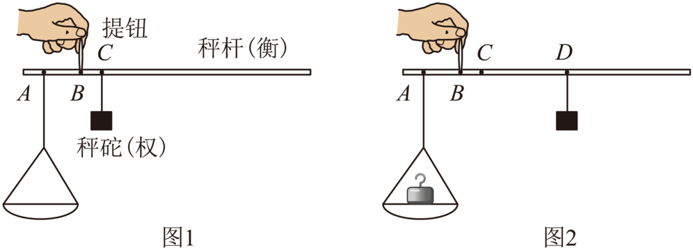

# Physics - 题目 1106

**ID**: 970140488bfb441bbb81c4bb62606a3e
**年级**: Grade 8
**难度**: Medium-Hard
**题型**: Experiment

## 题目
杆秤的秤砣和秤杆叫“权”和“衡”，寓意做任何事情都要权衡轻重。​​​​​​​‌那么，如何用小权平衡千钧之重?项目小组设计并制作杆秤。任务一：选材组装（1）选取一根较光滑的长竹筷、塑料盘、细线、重物，按如图1所示用小刀在秤杆上 $\mathrm{A}$ 、 $B$ 处刻刀口，分别用于固定秤盘和提纽。提纽位置 $B$ 即是杠杆的点。任务二：标定刻度（2）定盘星：秤盘不放物体时，提起提纽，调节秤砣位置使秤杆在位置平衡，用记号笔标出秤砣细线在杆上位置 $C$ ，标记为“ $0{\rm{g}}$ ”，即定盘星（杆秤的零刻度线）。此步骤抵消秤杆和秤盘的影响，确保后续测量从“零”开始。（3）定星花：在秤盘上放 $100{\rm{g}}$ 砝码，手提提纽，调节秤砣位置使秤杆水平平衡，标出秤砣细线在杆上的位置 $D$ （如图2），标记为“g”，再将位置 $C$ 到位置 $D$ 之间分为10等份，依次标上相应刻度。（4）定量程：按每一等份g推算，在杆的最远端标出称量最大值。任务三：测试调整（5）用刻度尺测出零刻度线到提纽的距离 $CB=2.0{\rm{c}}{\rm{m}}$ ，位置 $D$ 刻度线到提纽的距离 $DB=6.0{\rm{c}}{\rm{m}}$ 。将橡皮擦放入秤盘，调节秤砣使杆秤水平平衡，此时秤砣细线到提纽的距离为 $2.5{\rm{c}}{\rm{m}}$ ，则这块橡皮擦质量为g。任务四：改进优化（6）若要增大此杆秤的称量最大值，改进的方法是。若要提高此杆秤的称量精度，改进的方法是。

## 解答

1. （1）用以固定提纽和秤盘位置，提纽位置B即是杠杆绕着转动的点，是支点。
2. （2）秤盘不放物体时，提起提纽，调节秤砣位置使杆在水平位置平衡，既便于测量力臂，也能消除杠杆自重对平衡的影响。
3. （3）在秤盘上放100g砝码，手提提纽，调节秤砣位置使秤杆在水平位置平衡，标出秤砣细线在杆上位置D（图2），记为100g。
4. （4）根据杠杆平衡条件 $F{{}_{1}}l{{}_{1}}=F{{}_{2}}l{{}_{2}}$ ，开始时（图1）m_{盘}g×AB=m_{砣}g×BC
5. 放上物体后（图2）有 $\left ({m+m{{}_{盘}}}\right )g\times AB=m{{}_{砣}}g\times BD$
6. 故 $mg\times AB=m{{}_{砣}}g\times CD$
7. 因为是正比例函数，故刻度是均匀的。所以位置 $C$ 到位置 $D$ 之间分为10等份，每一份的距离为 $\frac {100{\rm{g}}}{10}=10{\rm{g}}$
8. （5）用刻度尺测出零刻度线到提纽的距离CB=2.0cm，位置 $D$ 刻度线即100g刻度线到提纽的距离DB=6.0cm。将橡皮擦放入秤盘，调节秤砣使杆秤水平平衡，此时秤砣细线到提纽的距离为2.5cm，根据mg×AB=m_{砣}g×CD
9. 则有 $100{\rm{g}}\times 10{\rm{N}}/kg\times AB=m{{}_{砣}}\times 10{\rm{N}}/kg\times \left ({6.0cm-2.0cm}\right )$ ① $m{{}_{橡皮}}\times 10{\rm{N}}/kg\times AB=m{{}_{砣}}\times 10{\rm{N}}/kg\times \left ({2.5cm-2.0cm}\right )$ ②
10. 联立①②解得橡皮的质量m_{橡皮}=12.5g
11. （6）若要用此杆秤称量更大质量的物体，在秤砣不变时，根据 $\left ({m+m{{}_{盘}}}\right )g\times AB=m{{}_{砣}}g\times BD$
12. 可知，将支点即提纽B向左移动。
13. 要提高此杆秤的称量精度，则要减小分度值，此时相同长度的量程减小，根据 $\left ({m+m{{}_{盘}}}\right )g\times AB=m{{}_{砣}}g\times BD$
14. 可知，将支点即提纽B向右移动。

## 知识点

**中文**:
  - 跨学科实践

**English**:
  - Interdisciplinary Practice

---
