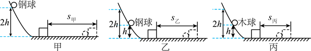

# Physics - 题目 516

**ID**: 9c0558db15e24504b5f092dd60b8e939
**年级**: Grade 8
**难度**: Medium-Hard
**题型**: Experiment

## 题目
如图所示，是用来探究“动能大小跟哪些因素有关”的实验装置图．（小球在光滑斜面上由静止开始下滑，到达底端的速度只与起点高度有关，起点越高，到达底端的速度就越大，运动小球撞击停在平面上的木块后，木块运动距离越长，说明小球具有动能越大）（1）分析比较实验甲与实验乙，可得出结论：；实验中被控制的物理量是；（2）分析比较实验乙与实验丙，可得出结论：；实验中被控制的物理量是；（3）实验结果表明，物体动能与物体的和有关，越大，越大，动能就越大。​​​​​​​‌

## 解答

1. （2）[3][4]比较乙实验与丙实验可知：钢球和木球到达平面上的速度相等，而钢球的质量比木球的质量大，结果是乙中的钢球具有的动能比丙中的木球的动能大，说明在速度相等的情况下，物体的质量越大，动能越大。
2. （3）[5][6][7][8]综合三个实验可知：物体的动能与物体的质量和速度有关，质量越大，速度越大，物体具有的动能越大。

## 知识点

**中文**:
  - 探究影响物体动能大小因素的实验

**English**:
  - Experiment: Factors Affecting Kinetic Energy

---
