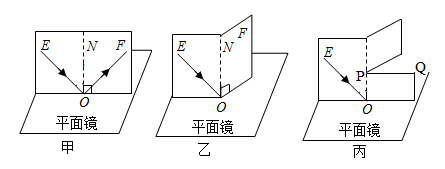

# Physics - 题目 1850

**ID**: 9ffb9d71357a4d76b38fefeb8ff4c076
**年级**: Grade 8
**难度**: Medium-Hard
**题型**: Experiment

## 题目
探究在“光反射的规律”时，小明进行了如图甲所示的实验：(1)先将平面镜平放在水平桌面上，再把白色硬纸板放在平面镜上且与镜面保持，白色的硬纸板表面应尽可能（选填“光滑”或“粗糙”），其目的是使光在纸板上发生，这样我们就能看清光的传播路径；(2)小明让一束光EO贴着硬纸板射到平面镜上，在硬纸板上会看到反射光线OF，然后将纸板绕ON向后折，如图乙所示，此时在NOF面上（选填“看到”或“看不到”）反射光线，此时，反射光是（选填“存在”或“不存在”）的；(3)为了进一步确定此时反射光线的位置，小明将硬纸板沿PQ剪开，将硬纸板的上半部分向后折，如图丙所示，发现在硬纸板右侧的（上部/下部）会看不到反射光线。​​​​​​​‌此实验现象说明反射光线、入射光线和法线（在/不在）同一平面；(4)在图甲中，如果让光线逆着OF的方向射向镜面，会看到反射光线沿着OE方向射出，这表明光反射时，光路是；(5)实验时，小明发现每次用铅笔把光的传播路径描下来非常不方便，认真思考后，他认为在正确操作时，只要在光传播的路径上标记两个合适的点就能确定了，他用到的光学知识是。

## 解答

1. (1)如果纸板没有与平面镜垂直放置，由于法线与镜面垂直，且反射光线、入射光线、法线在同一平面内，因此，当光贴着纸板沿EO入射时，不能在纸板上看到反射光。所以硬纸板放在平面镜上时，要保持与镜面垂直。
2. 为了看清楚纸板上的光路，白色的纸板材质应较粗糙些，光线射在上面发生了漫反射，反射光线射向各个方向，无论从哪个角度看，都能看得清楚。
3. (2)光在反射时，反射光线、入射光线、法线在同一平面内，将纸板绕ON向后折，如图乙所示，此时NOF与NOE不在同一平面，因此在NOF面上看不到反射光线，但反射光线仍在原来的位置。
4. (3)小李将纸板沿PQ剪开，将纸板的上半部分向后折，如图丙所示，发现在纸板右侧的下部会看到反射光线，而上部不会看到反射光线，此实验现象说明反射光线、入射光线和法线在同一平面。
5. (4)在图甲中，如果让光线逆着OF的方向射向镜面，原来的反射光变成入射光，会看到反射光线沿着OE方向射出，原来的入射光变成反射光，这表明光反射时，光路是可逆的。
6. (5)因为光在同种均匀介质中是沿直线传播的，因此沿光路用铅笔相隔一定距离时在纸板上各打两个点，再过两点用直尺、铅笔将光的路径画在纸板上(两点确定直线)。

## 知识点

**中文**:
  - 探究光的反射定律

**English**:
  - Investigation: Law of Reflection

---
