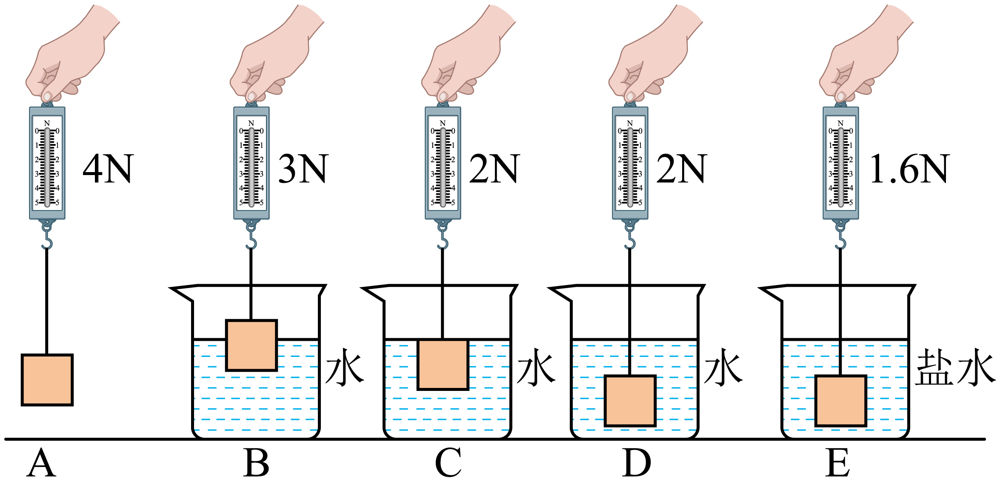
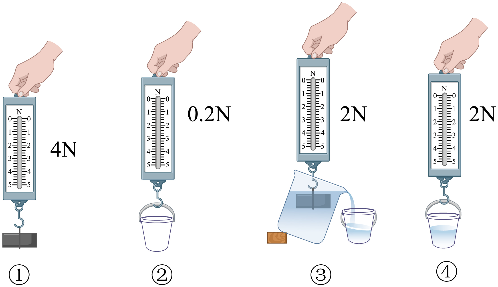
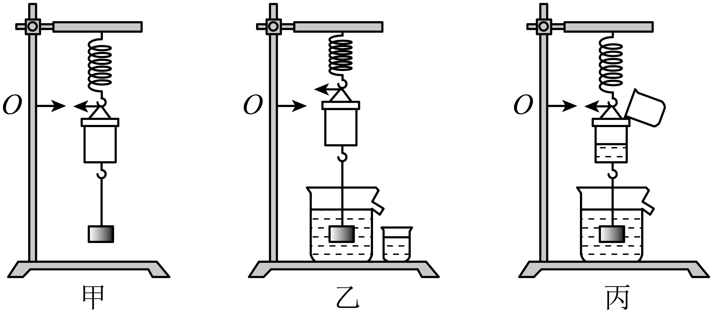

# Physics - 题目 346

**ID**: adb2e2937ef748119c68d8bdee7269eb
**年级**: Grade 8
**难度**: Medium-Hard
**题型**: Experiment

## 题目
如图所示，琪琪利用弹簧测力计、金属块、烧杯等器材探究“浮力大小与哪些因素有关”：（1）图B中金属块受到的浮力为N；（2）比较两图和图A可得出结论：物体受到的浮力大小与其排开液体的体积有关；（3）从实验现象可得出结论：物体受到的浮力大小与其浸没在液体中的深度，与液体的密度（均选填“有关”“无关”） ；（4）琪琪通过计算得出图E中盐水的密度为${\rm{k}}{\rm{g}}/{\rm{m}}{^{3}}$ ；（5）琪琪用这套装置验证阿基米德原理，如图所示，四个步骤的合理顺序是（用实验步骤对应的字母表示）；（6）实验中测得 $G{{}_{排}}=$N。​​​​​​​‌琪琪发现 $F{{}_{浮}}>G{{}_{排}}$ ，造成这种结果的原因不可能是（填序号）；a.烧杯中的水未装满        b.金属块没有完全浸没　　c.金属块碰触到烧杯的底部（7）琪琪对实验进行了改进：如图甲所示，在弹簧下端挂上小桶和金属块，记下弹簧伸长后指针的位置O。在溢水杯中装满水，把物体全部浸入水中，用小烧杯收集溢出的水，弹簧缩短，如图乙所示.将小烧杯中的水全部倒入小桶中，如果则验证了阿基米德原理。

## 解答

1. （1）根据称重法可知，图B中金属块受到的浮力为 $F{{}_{浮}}=G-F{{}_{1}}=4{\rm{N}}-3{\rm{N}}=1{\rm{N}}$
2. （2）要探究物体受到的浮力大小与其排开液体的体积有关，需要控制排开液体的体积改变，其他的量不变，因此比较BC两图和图A可得出结论：物体受到的浮力大小与其排开液体的体积有关。
3. （3）通过图ACD，浸没的深度变大，但是弹簧测力计的示数不变，由称重法 $F{{}_{浮}}=G-F{{}_{示}}$ 可知，物体受到的浮力大小与其浸没在液体中的深度无关。
4. 通过图ADE，浸入液体的体积相同，密度不同，弹簧测力计的示数不同，由称重法 $F{{}_{浮}}=G-F{{}_{示}}$ 可知，物体受到的浮力大小与液体的密度有关。
5. （4）由图可知，浸没在水中的浮力为 $F{{}_{浮水}}=G-F{{}_{{\rm{D}}}}=4{\rm{N}}-2{\rm{N}}=2{\rm{N}}$
6. 浸没在盐水中的浮力为 $F{{}_{浮盐水}}=G-F{{}_{{\rm{E}}}}=4{\rm{N}}-1.6{\rm{N}}=2.4{\rm{N}}$
7. 浸没时物体排开液体的体积等于物体的体积，由阿基米德原理可知， $\frac {F{{}_{浮盐水}}}{F{{}_{浮水}}}=\frac {ρ{{}_{盐水}}gV{{}_{排}}}{ρ{{}_{水}}gV{{}_{排}}}=\frac {ρ{{}_{盐水}}}{ρ{{}_{水}}}$
8. 所以盐水的密度为 $ρ{{}_{盐水}}=\frac {F{{}_{浮盐水}}}{F{{}_{浮水}}}ρ{{}_{水}}=\frac {2.4{\rm{N}}}{2{\rm{N}}}\times 1.0\times 10{^{3}}{\rm{k}}{\rm{g}}{\rm{/}}{\rm{m}}{^{{{3}}}}=1.2\times 10{^{3}}{\rm{k}}{\rm{g}}{\rm{/}}{\rm{m}}{^{{{3}}}}$
9. （5）为了减小误差并使操作最简便，可以先测量小桶的重力，再测量物体的重力，故顺序为②①③④。
10. （6）实验中测得 $G{{}_{排}}=F{{}_{4}}-F{{}_{1}}=2{\rm{N}}-0.2{\rm{N}}=1.8{\rm{N}}$
11. A．最初溢水杯中的水未装至溢水口，会使测得的 $G{{}_{排}}$ 减小，出现 $F{{}_{浮}}>G{{}_{排}}$ ，故A不符合题意；
12. B．由阿基米德原理可知，物体排开液体的重力等于自身受到的浮力，与物体是否浸没无关，金属块没有完全浸没，不会影响结果，故B符合题意；
13. C．步骤C中，石块浸没后，碰触到溢水杯的底部，不影响 $G{{}_{排}}$ 的大小，但会使F_{3}的值减小， $F{{}_{浮}}$ 的值增大，出现 $F{{}_{浮}}>G{{}_{排}}$ ，故C不符合题意。
14. （7）乙图的弹簧比甲图的弹簧缩短了，物体浸入水中会受到向上的一个托力，这个托力就是浮力，说明金属块受到浮力的作用。丙图中是把物体排开的水倒入到弹簧测力计下面挂的小烧杯中，弹簧指针又恢复到位置O，说明物体排开水的重力等于物体在水中所受的浮力，即 $F{{}_{浮}}=G{{}_{排}}$ ，则验证了阿基米德原理。

## 知识点

**中文**:
  - 实验探究阿基米德原理
  - 探究影响浮力大小因素的实验

**English**:
  - Experiment: Investigating Archimedes' Principle
  - Experiment: Factors Affecting Buoyancy

---
