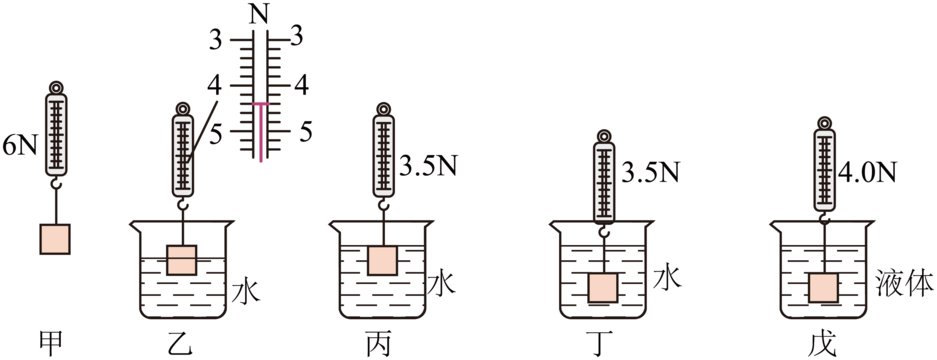
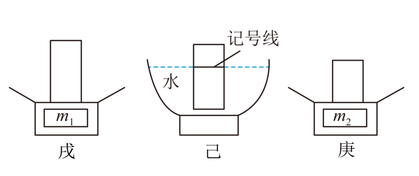

# Physics - 题目 1785

**ID**: b845791cc634479c95fa87b6cdf25903
**年级**: Grade 8
**难度**: Medium-Hard
**题型**: Experiment

## 题目
探究“浮力大小与哪些因素有关”的实验，将同一金属块按如图中步骤进行实验：（1）乙图中弹簧测力计的示数为N，由甲、乙、丙三图可知，其他条件一定时，浮力大小与排开液体的体积有关；由甲、丙、丁三图可知，其他条件一定时，浮力大小和浸没的深度（选填“有关”或“无关”）；由甲、丁、戊三图可知，其他条件一定时，浮力大小和有关。​​​​​​​‌（2）小明对甲、乙、丙、丁四个步骤进行了观察研究，能正确反映弹簧测力计的示数F和金属块下表面在水中的深度h关系的图像是如图中。（填写序号，金属块未接触容器底）

## 解答

1. （1）图中的弹簧测力计分度值为 $0.2{\rm{N}}$ ，指针所对的示数为 $4.4{\rm{N}}$ 。
2. 根据甲、丙、丁两图可知，液体都是水，密度相同，物体都是浸没，排开水的体积相同，物体浸没的深度不同，根据称重法可知浮力相同，因此可知浮力大小和浸没的深度无关。
3. 由甲、丁、戊可知，同一物体浸没在不同的液体中，液体的密度不同，排开液体的体积相同，弹簧测力计的示数不同，由称重法可知，受到的浮力不同，可知浮力大小和液体的密度有关。
4. （2）由甲、乙、丙、丁四个步骤可知，开始浸入时（未浸没），随着金属块浸在水中的深度越大，排开水的体积越大，则受到的浮力越大，根据称重法可知，弹簧测力计的示数减小，当金属块浸没后，排开水的体积不变，随着金属块浸在水中的深度越大，受到的浮力不变，根据称重法可知，弹簧测力计的示数不变，所以随着深度增大，弹簧测力计的示数先减小后不变，因此能正确反映弹簧测力计的示数F和金属块下表面在水中的深度h关系的图像应是D，故D符合题意，A、B、C不符合题意。
5. （3）用电子秤测出某圆柱体蜡块的质量为 $m{{}_{1}}$ ，蜡块的重力 $G=m{{}_{1}}g$
6. 将蜡块放入水中，静止时蜡块竖直漂浮，则 $F{{}_{浮}}=G$ ，由阿基米德原理和浮沉条件知 $ρ{{}_{水}}gV{{}_{排}}=m{{}_{1}}g$
7. 解得蜡块排开水的体积 $V{{}_{排}}=\frac {m{{}_{1}}}{ρ{{}_{水}}}$
8. 取出蜡块擦拭干净，并沿记号水平切下没入水中的部分（不计损耗），称其质量为 $m{{}_{2}}$ ，蜡块浸入水中的体积 $V{{}_{2}}=\frac {m{{}_{2}}}{ρ{{}_{蜡}}}=V{{}_{排}}$
9. 则有 $\frac {m{{}_{2}}}{ρ{{}_{蜡}}}=\frac {m{{}_{1}}}{ρ{{}_{水}}}$
10. 得蜡块的密度表达式 ${\rm{ρ}}{{}_{蜡}}=\frac {m{{}_{2}}ρ{{}_{水}}}{m{{}_{1}}}$

## 知识点

**中文**:
  - 利用浮力知识测密度
  - 探究影响浮力大小因素的实验

**English**:
  - Measuring Density using Buoyancy
  - Experiment: Factors Affecting Buoyancy

---
