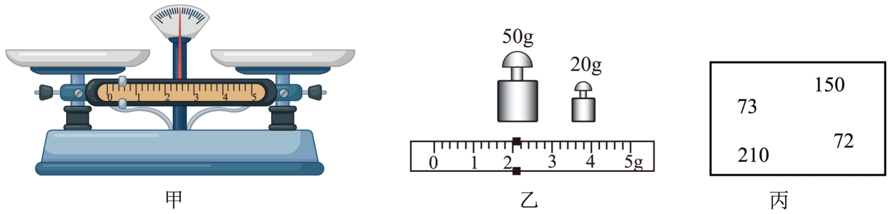

# Physics - 题目 2009

**ID**: c22b9dee17f040889ebbc16c62f1d6bc
**年级**: Grade 8
**难度**: Medium-Hard
**题型**: Experiment

## 题目
小明想测量咸鸭蛋的密度，由于咸鸭蛋无法放入量筒中，于是他找来了烧杯和足量的水（水的密度 $ρ{{}_{水}}=1{\rm{g}}/{\rm{c}}{\rm{m}}{^{3}}$ ），利用天平进行了如下实验：（1）如图甲所示是小明已经调好的天平，你认为他在调节天平过程中存在的问题是，改正错误后，他应该向（填“左”或“右”）调节平衡螺母，天平才能重新平衡；（2）小明用调节好的天平测量咸鸭蛋的质量，当天平平衡时右盘砝码和游码如图乙所示，咸鸭蛋的质量 $m{{}_{1}}$ 为g；（3）向烧杯中加入适量的水，用天平测出烧杯和水的总质量 $m{{}_{2}}$ ；（4）将咸鸭蛋放入装有水的烧杯中浸没，待液面静止时，用记号笔在烧杯侧壁水面的位置做标记；（5）取出烧杯中的咸鸭蛋，用天平测出此时咸鸭蛋的质量 $m{{}_{3}}$ ；（6），用天平测出此时烧杯和水的总质量 $m{{}_{4}}$ 。​​​​​​​‌（7）小明忘记将实验数据及时填入表格中，只将数据写在了草纸上如图丙所示。这些数据正确的填法是（填选项）。由此可知咸鸭蛋的密度为${\rm{g}}{\rm{/}}{\rm{c}}{\rm{m}}{^{{\rm{3}}}}$ 。咸鸭蛋的质量 $m{{}_{1}}{\rm{/}}{\rm{g}}$①烧杯和水的总质量 $m{{}_{2}}{\rm{/}}{\rm{g}}$②咸鸭蛋的质量 $m{{}_{3}}{\rm{/}}{\rm{g}}$③烧杯和水的总质量 $m{{}_{4}}{\rm{/}}{\rm{g}}$④咸鸭蛋的密度 ${\rm{g}}{\rm{/}}{\rm{c}}{\rm{m}}{^{{\rm{3}}}}$

## 解答

1. （1）[1][2]由图甲可知，在调节天平过程中，游码没有放在零刻度线处；由于游码没有放在零刻度线处，改正错误后，指针将偏向分度盘中线的左侧，应该向右调节平衡螺母，天平才能重新平衡。
2. （2）[3]由图乙可知，咸鸭蛋的质量
3. m_{1}=50g+20g+2g=72g
4. （6）[4]根据前面可知，取出鸭蛋后，水面从标记处下降，此时应该向烧杯中加水直到标记处，用天平测出此时烧杯和水的总质量 $m{{}_{4}}$ 。
5. （7）[5]由（2）可知咸鸭蛋的质量是72g，取出烧杯中的咸鸭蛋，咸鸭蛋沾有水，质量稍大于72g，由图丙可知，咸鸭蛋的质量m_{3}=73g；将咸鸭蛋放入装有水的烧杯中浸没，水面升高，将咸鸭蛋拿出，向烧杯中加水直到标记处，烧杯和水的总质量大于原来烧杯和水的总质量m_{2}，所以m_{4}=210g，m_{2}=150g，故选B。
6. [6]将咸鸭蛋拿出，带出水，再向烧杯加入水，包含了带出水的质量，对实验不会产生影响，测量的密度是准确的，咸鸭蛋的体积等于后来加入水的体积，咸鸭蛋的密度
7. $ρ{\rm{=}}\frac {m{{}_{1}}}{V}=\frac {m{{}_{1}}}{V{{}_{加水}}}{\rm{=}}\frac {m{{}_{1}}}{\frac {m{{}_{4}}-m{{}_{2}}}{ρ{{}_{水}}}}{\rm{=}}\frac {72{\rm{g}}}{\frac {210{\rm{g}}-150{\rm{g}}}{1{\rm{g}}{\rm{/}}{\rm{c}}{\rm{m}}{^{3}}}}{\rm{=}}1.2{\rm{g}}{\rm{/}}{\rm{c}}{\rm{m}}{^{3}}$

## 知识点

**中文**:
  - 固体密度的测量实验

**English**:
  - Experiment: Measuring Density of Solids

---
