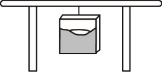

# Physics - 题目 2664

**ID**: c4bbdc09e92a40d99fc2102b74d55243
**年级**: Grade 8
**难度**: Medium-Hard
**题型**: Experiment

## 题目
物理兴趣小组的同学想探究大气压强的大小，他们拿来一个带挂钩的吸盘，将吸盘紧压在厚玻璃板的下表面，用一个可装细沙的购物袋（质量不计）挂在挂钩下、如图所示，向袋里逐渐注入细沙直至吸盘被拉下来，由此可得到大气压的大小。​​​​​​​‌（1）本实验主要的测量器材：刻度尺、；（2）需要直接测量的物理量：、；（3）大气压的表达式p＝；（4）如果测出的大气压仅为0.8×10^{5}Pa，实验中可能存在的问题是。

## 解答

1. （1）[1]根据 $p=\frac {F}{S}$ 可知，需要测量装细沙的购物袋对吸盘的拉力，即购物袋的重力，可以通过弹簧测力计直接测重力或者用天平测质量，根据 $G=mg$ 计算得出，所以选择的测量器材为：弹簧测力计（天平、案秤、台秤），刻度尺。
2. （2）[2][3]弹簧测力计直接测细沙受到的重力G（细沙的质量m），刻度尺可以直接测吸盘的直径D（吸盘的半径r）。
3. （3）[4]根据压强公式推导出表达式
4. $p=\frac {F}{S}=\frac {G}{πr{^{2}}}=\frac {G}{π{\left({\frac {D}{2}}\right)^{2}}}=\frac {4G}{πD{^{2}}}=\frac {4mg}{πD{^{2}}}=\frac {mg}{πr{^{2}}}$
5. （4）[5]测量值比标准大气压小，可能的原因有：吸盘中的空气没有完全被挤出、接触面没有处理干净、吸盘与玻璃板接触不紧密、存在漏气等现象会使吸盘内外均受压力作用，吸盘内外受到的压力差小于大气压力，所以会使得拉开吸盘的拉力变小，因为吸盘的面积不变，因此会使得测得的压强偏小。

## 知识点

**中文**:
  - 大气压强的测量及标准大气压

**English**:
  - Measurement of Atmospheric Pressure & Standard ATM

---
