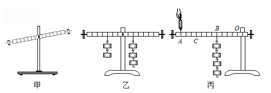

# Physics - 题目 2117

**ID**: c4f13e434a55433e8719ae0b05c1149d
**年级**: Grade 8
**难度**: Medium-Hard
**题型**: Experiment

## 题目
小明和小华做“探究杠杆的平衡条件”实验。​​​​​​​‌（所用钩码均相同）(1)实验前，杠杆静止如图甲，则应将平衡螺母向（选填“左”或“右”）移动；调节杠杆在水平位置平衡的目的是：；(2)如图乙，杠杆在水平位置平衡。由此小明得出杠杆的平衡条件：动力×动力臂＝阻力×阻力臂。小华认为他的结论不可靠，理由是：；(3)若在图乙中的杠杆两侧各添加一个钩码，杠杆将会（选填“左端下沉”“保持平衡”或“右端下沉”）；(4)小华用图丙所示装置进行实验：在保持杠杆水平平衡的条件下，将弹簧测力计逐渐向右倾斜，弹簧测力计的示数会逐渐，其原因是：阻力和阻力臂一定时，动力臂；（选填“变大”或“变小”）(5)小华继续研究杠杆的机械效率。在B点悬挂总重为G的钩码，弹簧测力计在A点施加竖直向上的拉力F，使杠杆缓慢匀速上升，用刻度尺测出A、B两点上升的高度分别为h_{1}、h_{2}，则：①杠杆机械效率的表达式为η＝；（用测量的物理量符号表示）②若只将测力计的作用点由A点移至C点，仍将钩码提升相同的高度，不计摩擦，杠杆的机械效率将（选填“变大”“变小”或“不变”）。

## 解答

1. (1)[1]调节杠杆在水平位置平衡，杠杆右端偏高，左端的平衡螺母应向上翘的右端移动，使杠杆在水平位置平衡。
2. [2]杠杆在水平位置平衡，力臂沿着杠杆，便于测量力臂大小。
3. (2)[3]小明仅根据一组实验数据就得出结论，实验结论具有偶然性，不具有普遍性，。
4. (3)[4]设一个钩码重为G，一格的长度为L，若两侧分别增加一个钩码，则左侧为
5. $3G\times 3L＝9GL$
6. 右侧为
7. $4G\times 2L＝8GL$
8. 因为 $8GL＜9GL$ ，即左侧力与力臂的乘积大于右侧力与力臂的乘积，故杠杆左端下沉。
9. (4)[5][6]小华用图丙所示装置进行实验：在保持杠杆水平平衡的条件下，将弹簧测力计逐渐向右倾斜，阻力、阻力臂不变，动力臂逐渐变小，根据杠杆平衡条件可知，动力逐渐变大，即弹簧测力计示数将逐渐增大。
10. (5)[7]克服钩码重力做的是有用功
11. $W{{}_{有用}}＝Gh{{}_{2}}$
12. 总功是
13. $W{{}_{总}}＝Fh{{}_{1}}$
14. 杠杆的机械效率为
15. $η=\frac {W{{}_{有用}}}{W{{}_{总}}}\times 100\%=\frac {Gh{{}_{2}}}{Fh{{}_{1}}}$
16. [8]将测力计的作用点由点A移至C点，O、B位置不变，仍将钩码提升相同的高度，这时有用功和总功都不变，因此机械效率不变。

## 知识点

**中文**:
  - 其他机械的机械效率的测量实验
  - 探究杠杆的平衡条件实验

**English**:
  - Experiment: Measuring Efficiency of Other Machines
  - Experiment: Equilibrium Conditions of Levers

---
