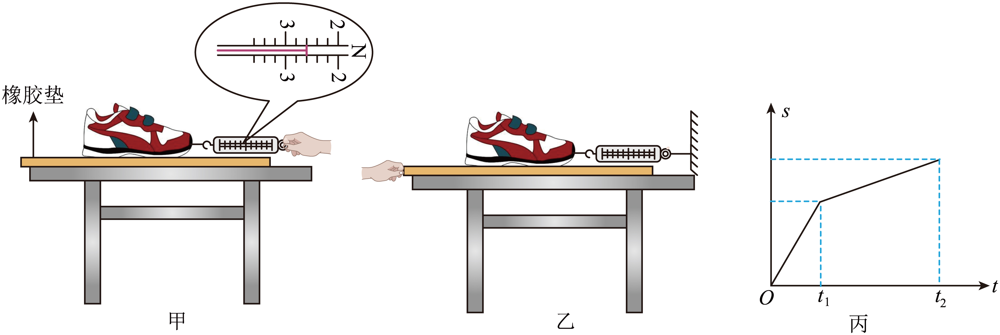

# Physics - 题目 977

**ID**: cb31a7c681944f7b8d64fa203e887c0a
**年级**: Grade 8
**难度**: Medium-Hard
**题型**: Experiment

## 题目
在学习了摩擦力知识后，小明和小华想用所学的知识进一步探究运动鞋的鞋底防滑效果，他们带来了洗干净的运动鞋，又准备了一张练习立定跳远用的橡胶垫，一个弹簧测力计，一个石块和细线。​​​​​​​‌（1）为了准确地测量滑动摩擦力的大小，小明认为应该让运动鞋沿水平方向做匀速直线运动，根据原理，可知拉力大小等于摩擦力；（2）小明将自己的运动鞋放在水平桌面的橡胶垫上，按正确的方法拉动，读出了弹簧测力计的示数如图甲所示为N；若在某次实验中，小明拉动运动鞋的路程-时间图像如图丙所示。 $0\sim t{{}_{1}}$ 和 $t{{}_{1}}\sim t{{}_{2}}$ 时间内弹簧测力计的示数分别为 $F{{}_{1}}$ 和 $F{{}_{2}}$ ，则 $F{{}_{1}}$$F{{}_{2}}$ （选填“ $>$ ”“ $<$ ”或“ $=$ ”）；（3）小华经过思考改进了小明的实验，让弹簧测力计和鞋保持静止，拉动鞋下的橡胶垫进行测量（如图乙所示），弹簧测力计示数为 $F{{}_{3}}$ ，此时鞋底受到（选填“静”或“滑动”）摩擦力。接着，把石块放进鞋子，再把鞋平放在橡胶垫上进行实验，弹簧测力计示数为 $F{{}_{4}}$ ，发现拉力 $F{{}_{4}}>F{{}_{3}}$ ，分析两次实验数据可以得出，滑动摩擦力与有关。下列各种现象中，利用该实验结论的是。

## 解答

1. （1）运动鞋沿水平方向匀速直线运动时，水平方向所受的拉力和滑动摩擦力是一对平衡力，据二力平衡可知，拉力大小等于摩擦力。
2. （2）图甲中，弹簧测力计的分度值为0.2N，示数为2.6N。
3. 由图丙知，两个时间段内的路程-时间图像都是倾斜的直线，运动鞋都是做匀速直线运动，则所受的滑动摩擦力都等于拉力，而两个时间段的压力及接触面的粗糙程度不变，所受的滑动摩擦力大小不变，所以两次测力计的示数相等，即F_{1}=F_{2}。
4. （3）图乙中，拉动鞋下的橡胶垫，则鞋相对橡胶垫是运动的，所受的是滑动摩擦力。
5. 把石块放进鞋子，再把鞋平放在橡胶垫上，则放进石块前后的两次拉动，接触面的粗糙程度相同，压力不同，放进石块后，压力变大了，测力计的示数也变大了（F_{4}>F_{3}），所以可得：滑动摩擦力与压力有关。
6. A．用力压住橡皮，擦去写错的字，这是在接触面的粗糙程度一定时，通过增大压力来增大摩擦，故A符合题意；
7. B．移动很重的石块时，在地上铺设滚木，这是将滑动摩擦力变为滚动摩擦来减小摩擦，故B不符合题意；
8. C．汽车在结冰的路面上行驶，在车轮上缠绕铁链，是为了在压力一定时，通过增大接触面的粗糙程度来增大摩擦，故C不符合题意。

## 知识点

**中文**:
  - 有关摩擦力的其他实验

**English**:
  - Other Experiments Related to Friction

---
