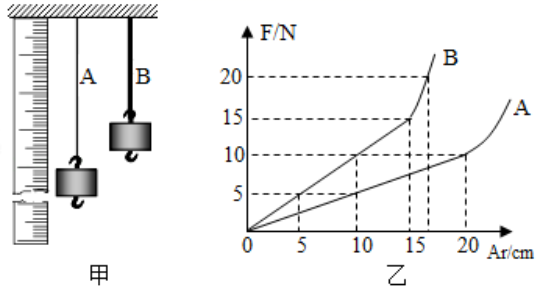

# Physics - 题目 1370

**ID**: cd1f2deb25604064b6675b4c821b1f98
**年级**: Grade 8
**难度**: Medium-Hard
**题型**: Experiment

## 题目
某实验小组的同学对A、B两根长度相同粗细不同的橡皮筋进行研究，将橡皮筋的一端固定，另一端悬挂钩码（图所示），记录橡皮筋受到的拉力大小F和橡皮筋的长度L，根据多组测量数据做出的图线如图所示：(1)分析右图中B图像可知：在拉力不超过N，橡皮筋伸长的长度与它所受的拉力成；(2)当在两根橡皮筋上悬挂重力为10N的物体时，橡皮筋A的伸长量为cm。​​​​​​​‌分别用这两根橡皮筋制成的弹簧测力计，用橡皮筋制成的测力计测量的精确程度高（选填“A”或“B”）；(3)根据力的作用是相互的，所以钩码对橡皮筋的拉力（大于/等于/小于）橡皮筋对钩码的拉力（即橡皮筋形变而产生的弹力）。其实英国物理学家胡克于1678年就提出（胡克定律）：弹簧在发生弹性形变时，弹簧的弹力F与弹簧的伸长量（或压缩量）x成正比，其大小表示为： $F=kx$ ，其中 $k$ 为劲度系数，其大小等于弹力与弹簧的伸长量（或压缩量）的比值。则根据上述信息：在弹性限度以内，若将本实验中两根粗橡皮筋并联起来后使用，其劲度系数 $k$ 为N/m。

## 解答

1. (1)[1][2]由右图可知，B橡皮筋在受到的拉力不超过15N的情况下，橡皮筋伸长量△x与橡皮筋受到的拉力大小F变化关系为一直线，说明橡皮筋的伸长△x与受到拉力F成正比。
2. (2)[3]橡皮筋的伸长△x与受到拉力F成正比例函数的关系，设 $F{{}_{{\rm{A}}}}=k{{}_{{\rm{A}}}}Δx{{}_{{\rm{A}}}}$ ，由图知，当 $F{{}_{{\rm{A}}}}$ ＝5N， $Δx{{}_{{\rm{A}}}}$ ＝10cm，将数据代入： $F{{}_{{\rm{A}}}}=k{{}_{{\rm{A}}}}Δx{{}_{{\rm{A}}}}$ ，得
3. $5{\rm{N}}\mathrm{=}k\times 10{\rm{c}}{\rm{m}}$
4. 解得
5. $k\mathrm{=}0.5{{\rm{N}}}/{{\rm{c}}{\rm{m}}}$
6. 所以
7. $F{{}_{{\rm{A}}}}\mathrm{=}\mathrm{0}\mathrm{.}\mathrm{5}Δx{{}_{{\rm{A}}}}$
8. 所以，当在两根橡皮筋上悬挂重力为10N的物体时，橡皮筋A的伸长量为
9. $Δx{{}_{{\rm{A}}}}\mathrm{=}\frac {10{\rm{N}}}{0.5{{\rm{N}}}/{{\rm{c}}{\rm{m}}}}\mathrm{=}20{\rm{c}}{\rm{m}}$
10. [4]由右图可知，在测量范围内，如F＝5N时，用橡皮筋A制成的测力计伸长10cm，而用橡皮筋B制成的测力计伸长5cm，所以根据受同样的力（在测量范围内）伸长量大的，测量精确高；用橡皮筋A制成的测力计测量的精确程度高。
11. (3)[5]由于一对相互作用力大小相等，所以钩码对橡皮筋的拉力等于橡皮筋对钩码的拉力（即橡皮筋形变而产生的弹力）。
12. [6]由右图可知，在测量范围内，如F＝5N时，用橡皮筋A伸长10cm，而当F＝10N时，橡皮筋B制成的测力计伸长10cm，即当拉力F为15N时，橡皮筋AB并联伸长的长度x为10cm，即x＝0.1m，将数据代入 $F=kx$ ，得
13. $k\mathrm{=}\frac {F}{x}\mathrm{=}\frac {15{\rm{N}}}{0.1{\rm{m}}}\mathrm{=}150{{\rm{N}}}/{{\rm{m}}}$

## 知识点

**中文**:
  - 物理常识及物理学史

**English**:
  - General Physics Knowledge and History

---
