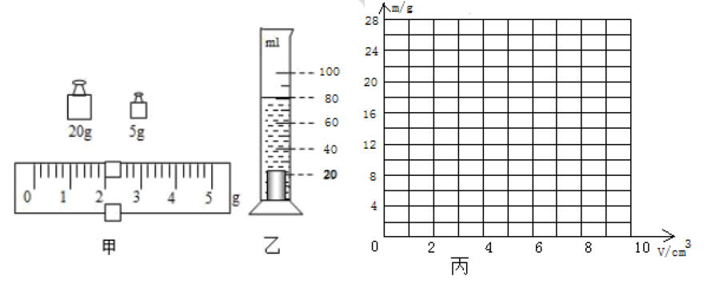

# Physics - 题目 1958

**ID**: cd81447dc6164b4c80d08fe61bd25dfe
**年级**: Grade 8
**难度**: Medium-Hard
**题型**: Experiment

## 题目
小明在“探究物质的质量与体积的关系”实验中；表一：物体ABC质量/g①14.621.6体积/cm^{3}②5.48.0表二：物体DEF质量9.020.315.5体积5.07.58.6（1）用调节好的天平称一个物体的质量，当把物体放到天平左盘时，右盘中的砝码和游码所处的位置如右图甲所示，天平平衡，请你将数据记录在表格内①；（2）将给物体放到盛有70cm^{3}水的量筒中，量筒中的水面如图乙所示，将物体体积记录在表内②；（3）按照上两步骤，小明继续测量了2个同种物质组成的物体的质量与体积，并将数据记录在下表一中，请你根据表中的数据在图丙的坐标纸上用“• ”描点，作出图像，观察图形并得出结论：；（4）小明由测量了3个不同物体的质量和体积，并将数据记录在表二中，请你根据表中的数据在图丙的坐标纸上用“×”描点（），观察分析做出判断：和是同种物质（选填D/E/F）；（5）一个与D相同物质组成的物体，体积是10cm^{3}，它的质量是g。​​​​​​​‌

## 解答

1. (1)[1]由图甲可知，游码对应的示数为2g，物体质量
2. m=20g+5g+2g=27g
3. 表格内①为27。
4. (2)[2]由图乙可知，物体和水的总体积为80ml，则物体的体积
5. V=V_{总}−V_{水}=80ml−70ml=10ml=10cm^{3}
6. 表内②为10。
7. (3)[3]利用描点法，将“27，10”“14.6，5.4”“21.6，8.0”三组数据描点，可得质量和体积变化图象如图：
8. 
9. [4]观察图象并得出结论：质量和体积的比值为一定值。
10. (4)[5] 根据表二中数据描点，如图所示：
11. 
12. [6][7]物质D
13. $\frac {9{\rm{g}}}{5{\rm{c}}{\rm{m}}{^{3}}}$ =1.8g/cm^{3}
14. 物质E
15. $\frac {20.3{\rm{g}}}{7.5{\rm{c}}{\rm{m}}{^{3}}}$ =2.7g/cm^{3}
16. 物质F
17. $\frac {15.5{\rm{g}}}{8.6{\rm{c}}{\rm{m}}{^{3}}}$ =1.8g/cm^{3}
18. 可见D、 F是同种物质。
19. (5)[8]物质D的密度是1.8g/cm^{3}， 物体的体积是10cm^{3}，所以它的质量为
20. m=ρV=1.8g/cm^{3}×10cm3=18g
21. 它的质量是18g。

## 知识点

**中文**:
  - 探究物质的质量与体积的关系

**English**:
  - Investigation: Relationship between Mass and Volume

---
